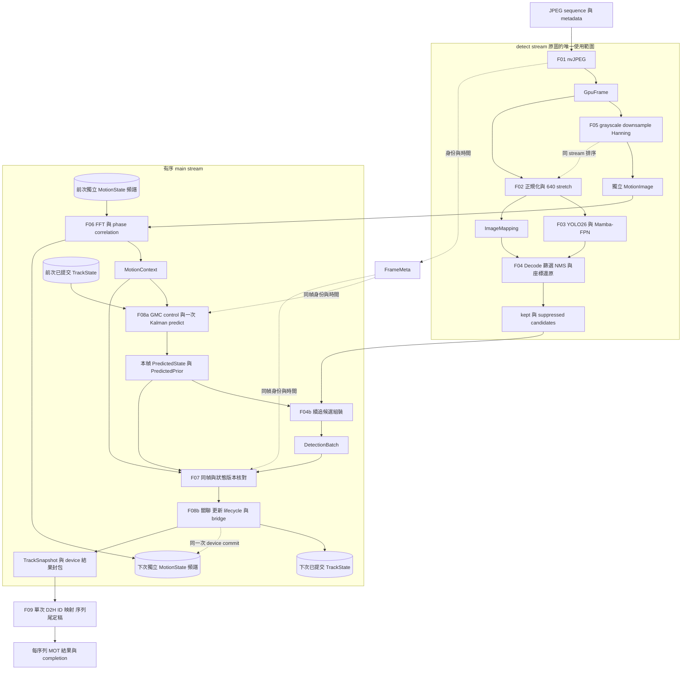
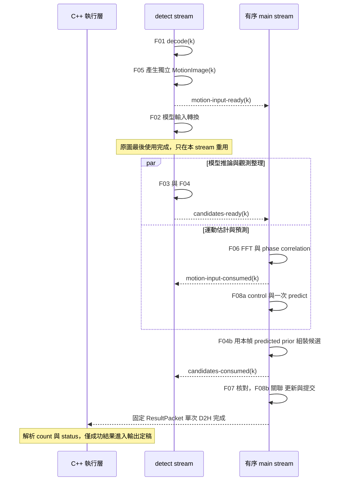

# Saccade v1 C++ GPU 資料流與架構規劃

狀態：設計草案。日期：2026-10-28。

這份規劃以舊 Saccade 的 C++／GPU 架構為依據，重新整理影像、觀測、軌跡與輸出的資料流。既有架構作為 v1 設計基線；後續實作應能逐項對應資料、狀態、依賴與完成條件。

## 1. 範圍與設計狀態

| 狀態 | 內容 |
| --- | --- |
| 已確定 | 從零重寫，不復用舊程式；實作採 C++／CUDA GPU 路徑，不使用 Python。 |
| 已確定 | 舊實驗數據不遷移，不要求保證舊實驗成績。 |
| 已確定 | 本階段只整理資料流與架構規劃。 |
| 沿用架構基線 | §1.1 列明的模型家族、觀測／GMC／追蹤主線、native sequence 輸入輸出與排程方向，作為重寫起點。 |
| 重抽象設計 | 顯式資料契約、狀態 owner、續追資格、完成條件與錯誤語義；差異集中列於 §9。 |
| OPEN | §9 的具體差異與工程規格；不重開 §1.1 已有依據的整體架構選型。 |

C++ host 負責設定、來源控制、工作提交、錯誤處理與 I/O；前處理、推論、觀測處理、鏡頭運動估計及追蹤的計算資料面留在 GPU。輸入邊界可能包含壓縮資料傳入或外部影像的 GPU 匯入；具體來源與解碼能力列於 §9。

下文的階段不對應固定的 class 或 kernel。一個 kernel 可以合併多個邏輯階段，但仍須遵守各階段的語義與資料依賴。

### 1.1 由舊架構收斂的 v1 設計基線

下表是本稿採用的重寫基線。重新實作不要求重選全部技術方向；若後續要改變其中一項，應記錄改變哪個資料契約及其理由。舊程式的驗證結果與效能數字不隨架構基線移轉。

| 基線 | v1 採用的架構 | 舊架構依據 |
| --- | --- | --- |
| B01 主線邊界 | geometry-first、ReID-free MOT；不把 embedding、crop bank、Redis、RAG 或 cognition 納入追蹤必要依賴。 | [ADR 019 Decision](../../saccade/docs/decisions/019-demote-reid-geometry-first-production-tracker.md)、[architecture §3](../../saccade/docs/architecture/README.md) |
| B02 第一個具體 profile | JPEG sequence＋序列 metadata → 每序列一份 MOT 結果；C++ native 入口。一般影片、RTSP 與多來源並行是擴充範圍。 | [native shipping boundary §3](../../saccade/docs/reference/native_runtime_shipping_boundary.md) |
| B03 偵測器 | YOLO26 backbone／neck＋Mamba-FPN head，P3／P4／P5，s 為起點；幀內推論。C++ GPU 推論以 TensorRT＋native CUDA scan 為規劃方向，不使用 Python 前向。 | [math model §4.1](../../saccade/docs/reference/math_model.md)；native 實現須符合本次 C++／GPU 要求 |
| B04 影像轉換 | RGB、CHW、float32 正規化至 0–1，再 stretch 到 640×640；保留回原圖的座標映射。主線不加入 tiling、letterbox、gamma 或 contrast 調整。 | [native resolved config §11.1](../../saccade/docs/reference/native_runtime_resolved_config.md)、[math model §1、§4.1](../../saccade/docs/reference/math_model.md) |
| B05 觀測形成 | anchor-free decode、sigmoid／class 選擇、篩選與穩定 compact、NMS、原圖 xyxy boxes；保留 class ID。suppression 的責任只執行一次。 | [math model §4.1–4.2](../../saccade/docs/reference/math_model.md) |
| B06 續追候選 | 從 NMS suppressed candidates 補回與本幀 predicted prior 重疊的觀測，只可續追、不可 birth；prior 在本幀 GMC control＋Kalman predict 後產生。 | [math model §9.1](../../saccade/docs/reference/math_model.md) 提供續追機制；prior 時點改變明列為 D06 |
| B07 鏡頭運動 | detect stream 上完成 grayscale／downsample／Hanning，交付獨立小型 MotionImage；main stream 的 phase correlation 使用前次獨立頻譜，產生 translation-only warp。MotionState 永不借用原圖。 | [math model §0、§5](../../saccade/docs/reference/math_model.md)；原圖與運動狀態分離明列為 D07 |
| B08 追蹤 | 8D constant-velocity Kalman、GMC control、幾何 cost／gate、分階段 sparse top-k＋單輪 auction bid／commit、birth／confirm／lost／remove，以及 bidirectional bridge relink。predict 每幀只做一次，top-k／auction／birth／bridge 使用 §3.2 的固定全序。 | [math model §6–§10](../../saccade/docs/reference/math_model.md)、[ADR 019](../../saccade/docs/decisions/019-demote-reid-geometry-first-production-tracker.md)；新決定性契約見 D09 |
| B09 輸出 | GPU 精簡 track snapshot → 輸出邊界；每序列首次出現順序的 ID 映射、MOT rows 與 sequence-tail 插值／定稿階段。保留此流程，插值窗口等值另訂。 | [native shipping boundary §5 B3–B4](../../saccade/docs/reference/native_runtime_shipping_boundary.md) |
| B10 排程 | serial 作依賴參考，double-buffer 為運行目標，`detect(k+1)` 與 `main(k)` 重疊。兩組候選 slots、獨立小影像 slots 與 host 端 JPEG staging；原圖是 detect stream 內的單一 buffer，main 頻譜與 TrackState 依 device 提交版本輪替；偵測串行，最多一個 detection 執行。跨 stream 協定見 [ASYNC_CONTROL](ASYNC_CONTROL.md)。 | [native resolved config §14.1](../../saccade/docs/reference/native_runtime_resolved_config.md)、[async ownership §2.1](../../saccade/docs/architecture/async_ownership_538.md)；v1 分離見 D07 |
| B11 設定與資源 | C++ 讀取單一 resolved 設定；語義參數顯式下發，graph 綁定的設定固定。模型等 run 資源可共用；tracker／GMC／frame pool／輸出按 sequence 隔離。 | [native resolved config §8、§13–§14](../../saccade/docs/reference/native_runtime_resolved_config.md) |

舊實作含不同 head 載入路徑；B03 選定的是新規劃方向，不表示舊版已具備或驗證整條 TensorRT-only 路徑。模型檔案、精度與 scan 相容規格仍須補齊，模型家族及 GPU 資料流已有基線。

## 2. 邏輯資料流



原圖只在 detect stream 上被 F05 與 F02 讀取。F05 先生成獨立小型 MotionImage，再發布 ready；main stream 不接觸原圖，可在模型推論仍執行時開始 F06。

main 的必要順序是 F06 GMC(k) → F08a GMC control＋predict(k) → PredictedPrior(k) → F04b(k) → F07 → F08b 關聯／更新。F04b 依賴本幀 GMC 與 predict，使用本幀原圖座標的 predicted boxes；偵測候選尚未 ready 時只延後 F04b，不阻止已滿足依賴的 F06／F08a。

主線啟用 translation GMC。第一幀的 `uninitialized`、估計失敗的 `invalid` 與有效估計的 `valid` 分開表示；診斷若明確停用 GMC，另用 `disabled`，不改變主線預設。

圖中的前次／下次狀態表示不同邏輯版本。F08a 的預測只是本幀工作版本，F08b 成功後才提交 TrackState，本幀頻譜也在同一次 device commit 中推進；基線模型沒有跨幀記憶。

## 3. 各階段的資料責任

| 階段 | 輸入 | 輸出 | 唯一責任與邊界 |
| --- | --- | --- | --- |
| F01 輸入與 GPU 影像準備 | JPEG sequence、序列 metadata | GpuFrame、FrameMeta | C++ 讀取壓縮資料，nvJPEG 產生 GPU RGB 影像並建立 frame 身份；尺寸／數量檢查及解碼錯誤與 EOF 分開。 |
| F02 模型輸入轉換 | GpuFrame、模型輸入規格 | 640×640 RGB CHW 模型輸入、ImageMapping | float32 正規化與 stretch；完整記錄原圖到模型座標的映射。 |
| F03 模型推論 | 模型輸入 | RawPredictions | YOLO26 backbone／neck 產生 P3／P4／P5，Mamba-FPN head 產生 cls／reg；基線為幀內推論。 |
| F04 觀測整理 | RawPredictions、ImageMapping、觀測政策 | DetectionCandidates | decode、class／score 選擇、篩選、穩定排列、NMS、座標還原；區分 kept 與 suppressed candidates，供 F04b 使用。 |
| F05 運動影像準備 | GpuFrame | 獨立 MotionImage、frame／座標資訊、ready | detect stream 在 decode 後先做 grayscale／downsample／Hanning；輸出與原圖不 alias。 |
| F06 鏡頭運動估計 | 本幀 MotionImage、前次獨立頻譜 MotionState | MotionContext、本幀獨立頻譜 | main stream 完成 FFT／phase correlation，記錄參考／目標與有效性；不持有原圖。 |
| F08a 預測前段 | FrameMeta、MotionContext、前次已提交 TrackState | PredictedState、PredictedPrior | 本幀套一次 GMC control 與 Kalman predict；prior 綁定本幀座標與預測版本，age 的推進也只發生一次。 |
| F04b 續追候選組裝 | DetectionCandidates、本幀 PredictedPrior | DetectionBatch | main stream 依 predicted boxes 選 suppressed candidates，明列資格並通過後段過濾；不得讀前幀未補償 boxes。 |
| F07 同幀資料匯合 | FrameMeta、DetectionBatch、MotionContext、PredictedState 版本 | TrackingInput | 核對 frame／epoch／座標／時間、預測版本及 device count／status；錯誤或 overflow 不進入關聯／提交，經結果封包回報。 |
| F08b 關聯與提交 | TrackingInput、PredictedState、追蹤政策 | 下一版 TrackState、TrackSnapshot、device 結果封包 | 幾何 gating／cost、sparse top-k／auction、measurement update、生命週期與 bridge；不再做 GMC／predict，成功後才提交。 |
| F09 結果定稿與交付 | device 結果封包、輸出政策 | MOT rows、序列完成記錄 | 每幀只作一次固定容量封包 D2H，再解析 count／status、ID 映射、序列尾插值／定稿與寫入。 |

偵測器可以把 decode／部分 suppression 合併到推論圖，但必須保留 F04b 所需的候選資訊，不因融合而丟失 continuation-only 路徑。suppression 的責任仍只執行一次，不要求為每個邏輯階段額外配置或複製 tensor。

### 3.1 追蹤內部資料順序

決策鏈為 GMC translation control → 8D constant-velocity Kalman predict → 本幀 PredictedPrior → F04b continuation-only 候選 → 幾何候選 gating／cost → 依優先序進行 sparse top-k、auction bid／commit → matched measurement update → unmatched／birth／confirm／lost／remove → bidirectional bridge 身份恢復 → TrackSnapshot。

F08a 不提前提交。age 以本幀預測後的版本判斷 prior eligibility，已達淘汰條件的 track 不進 PredictedPrior；與舊版先查 age 再 predict 的差異一併列於 D06。若 F04b／F08b 失敗，本幀工作版本作廢且序列失敗，不把已執行的 predict 當成成功更新，也不在同一狀態上重試而再次 predict。

幾何 cost 的架構包含 motion／IoU、occlusion-aware penalty 與 size-stability 等來源；其值及啟用表在新設定中明列。階段間保留已配對結果，後段只處理剩餘 track／detection。這是分階段貪婪關聯，不宣稱 full Sinkhorn、迭代收斂 auction 或全域最優配對。

首階段 DDA 等歷史開關是否保留，屬 §9 的簡化差異；不因此把整個關聯架構重新列為未選定。

### 3.2 Tracker 決定性契約

下列全序適用於相同有效輸入、cost／bid 與設定；不宣稱不同 GPU／浮點實現之間數值逐位相同。

本節比較鍵的 `cost` 明確指完整 scoring 後的 `rank_cost = -candidate_value`，其升序等價於 candidate value 降序。沿用的候選值包含 `exp(-lambda * association_cost) * aspect_penalty` 等完整權重；不能只取尚未套 aspect penalty 的原始 association cost 排 top-k。後文的 cost 平手指 rank_cost 平手，不改變非平手候選的既定主排序。

| 決策 | 主排序與平手順序 |
| --- | --- |
| sparse top-k | `(cost, track UID, candidate ID)` 字典序升序；每 track 的 top-k 中 track UID 固定，candidate ID 仍決定等 cost 順序。 |
| auction winner | bid 降序；bid 相同時，依 `(cost, track UID, candidate ID)` 字典序升序。保留 bid 的主評分語義，不以 cost-first 取代不同 bid 的比較。 |
| birth／slot 配置 | 依穩定 candidate ID 順序配置本 epoch 不重用的 track UID；slot 選擇也使用固定順序，不用 atomic 到達先後編身份。 |
| bridge 選擇／衝突 | lost 候選以 bridge cost 升序，平手依 lost track UID、candidate ID；多個 claim 爭同一 lost 時保留宣告的主 score 降序，平手依 claim 的穩定 track UID、candidate ID 升序。 |

candidate ID 在 F04 篩選前由固定模型輸出序號建立，kept／suppressed／compact 之後保留；track UID 表示不可重用的 track instance，與可被 bridge 改寫的輸出 ID、可重用的記憶體 slot 分開。

每個 auction stage 先固定 candidate、未配對集合及 stage-start price snapshot，從同一份唯讀資料產生所有 bid；然後求 winner，最後 commit。當輪 atomic resolution 只寫獨立 winner 結果，不回寫仍被當輪 bid 計算讀取的 price；下一 stage 才能讀取本 stage 的配對提交。

比較鍵使用宣告的有限浮點 cost／bid，`-0` 正規化為 `+0`，NaN／Inf 的可參與候選視為計算錯誤；不可配對項以獨立 valid mask 排除。比較鍵不另做有損量化。若以 `atomicMax` 打包 key，主欄與 tie 欄的升降序、位寬、範圍及無碰撞編碼必須與上述全序完全等價；升序欄位須轉為偏好較小值的序碼。位寬不足就分階段比較，不能截斷 UID 或讓溢位改變順序。具體封裝在 P05 補齊。

## 4. 跨階段資料契約

以下名稱代表邏輯資料，尚未指定 C++ 型別、記憶體排列與 ABI。

| 資料 | 必須攜帶或能明確取得的資訊 |
| --- | --- |
| FrameMeta | 來源 ID、連續處理區段 epoch、來源 frame ID、接收／處理序號、來源時間及 timebase、接收時間、原圖尺寸與方向。來源 frame ID 和處理序號分開，保留缺幀事實。 |
| GpuFrame | FrameMeta 身份、device、像素格式／色彩規格、尺寸、pitch／layout、有效影像區域、buffer lease、完成依賴。 |
| MotionImage | frame／epoch、原圖與小影像尺寸／映射、downsample／window key、獨立 GPU 小影像與 ready／last-use；不得 alias GpuFrame。 |
| ImageMapping | 原圖與模型／運動影像座標之間的轉換、有效區域、resize／crop／pad 參數；裁切只在保留的影像區域內有反向映射。 |
| RawPredictions | frame 身份、模型輸出 schema、tensor 的形狀／dtype／layout、box／class／score 編碼、buffer lease 與完成依賴。 |
| DetectionCandidates | frame 身份、原圖 xyxy boxes、原始 score／class、候選 ID、kept／suppressed 標記、穩定順序、有效數量／容量、GPU buffers 與完成依賴。 |
| PredictedState／PredictedPrior | 來源／epoch、來源 TrackState 版本、目標 frame、使用的 MotionContext、GPU 預測狀態／prior boxes／classes／UID／資格與 device count。由 F08a 產生本幀唯讀 prior，尚未提交；不得取前次 boxes 冒充。 |
| DetectionBatch | frame 身份、原圖 xyxy boxes、observed score 與 association score 的各自含義、class／候選 ID、`can_continue`／`can_birth` 資格、device 有效數量／容量／overflow、GPU buffers 與完成依賴。 |
| MotionContext | 參考與當前 frame 身份、座標系、轉換方向、運動模型、估計有效性；演算法提供時附信心資訊。狀態至少可區分 disabled、uninitialized、valid、invalid。 |
| TrackingInput | 同幀 FrameMeta、最終 DetectionBatch、MotionContext、使用的 PredictedState／PredictedPrior 版本，以及相對上次成功更新的時間關係。 |
| TrackState | 所屬來源／epoch、最後成功提交的 frame、身份與生命週期、位置／運動狀態及算法需要的歷史。由該 session 唯一寫入。 |
| TrackSnapshot | frame 身份、track 身份、box、各分數的明確語義、生命週期／觀測或預測標記、有效數量、結果是否定稿、buffer lease 與完成依賴。 |
| ResultPacket | 固定容量 GPU 封包：frame／epoch、device count、status／overflow／必要失敗資訊與最多 capacity 筆精簡 tracks；單次 D2H 後 host 才解析，僅前 count 筆有效。 |

所有候選／prior／track／top-k 的有效數量與中途 overflow 狀態都存放在 device。kernel 依宣告容量 launch，再於 kernel 內讀 count／valid mask；host 不為決定下一步工作量讀回 count。每幀資料面唯一 D2H 是完整 ResultPacket，不能拆成先讀 count 再變長複製 rows。

### 4.1 時間與身份

來源時間用於描述影像發生時間，接收時間用於描述進入系統的時間；量測延遲的時鐘域與影像時間分開。JPEG sequence 基線採 frame index 與序列 frame rate 定義時間，追蹤按連續 frame step 推進；可變時間差追蹤屬擴充設計。

同一來源／epoch 的 TrackState 按處理順序提交。即使未來把不同來源放進同一 batch，也不能讓同來源的後幀先更新狀態。缺幀、跳幀與亂序不得靠重新編號消失。

內部 track 身份由「來源、epoch、local track ID」辨認。MOT 輸出 ID 在每個 sequence 按首次出現順序由 1 起映射，不延續到下一個 sequence；基線不做跨來源身份關聯。

### 4.2 座標與運動方向

DetectionCandidates、DetectionBatch 與 TrackSnapshot 採原圖像素 xyxy 座標，輸出 MOT rows 時才轉為 left／top／width／height。640 stretch 的 x／y scale 分開記錄；像素取樣、clipping 與退化框處理的精確規格待 §9 補齊。

MotionContext 描述「參考幀座標 → 當前幀座標」，基線為 translation-only 的 2×3 warp。估計在縮小影像上執行時，位移交付前轉回原圖尺度；affine／homography 是改變 B07 的差異方案。

運動參考幀可以是前一個已處理幀，但必須與 tracker 的狀態參考對齊。若兩者不同，須先明確組合轉換或拒絕本次輸入，不能只因兩者都有一個 warp 就直接套用。

F08a 將前版狀態的座標／時間推進到 k，PredictedPrior 的目標 frame 必須等於 DetectionCandidates 的 k。F04b 只比較這兩份本幀座標資料；F07 再核對最終輸入使用同一個預測版本，不將相同像素單位誤當相同參考時點。

### 4.3 空觀測與容量

成功處理影像但沒有 detection，是有效的空 DetectionBatch，F08 仍須依新追蹤規格處理時間與生命週期。沒有 track 輸出時也保留該幀的處理記錄。

空觀測、缺幀、解碼失敗與容量 overflow 是不同事件。離線 sequence 基線不主動丟幀，容量不足或必要影格缺失時本序列失敗，不把部分結果當完整觀測／完整序列。容量數值與是否新增可配置的截斷模式列於 §9。

continuation-only 候選的 `can_birth=false` 是硬限制，不能被高 score 或後段 birth 邏輯繞過。資格欄位不取代分數分段規則；新規格要分清 observed score、association score 與資格，保留 B06 的續追意義。

### 4.4 設定治理

本節規則已採納，細化 B11 與 D05；schema、解析器及檢查工具仍待 C++ 實作。

所有執行設定經同一個解析入口形成單一 resolved 設定，明列 schema 版本與展開後的預設值。若提供 CLI／環境變數覆寫，僅接受已宣告的項目，採用明定的優先序，並將有效值與來源記入 resolved 記錄；階段與 kernel 不再另讀環境變數改變決策。設定在開始提交 frame 前完成驗證，run 期間保持不變。

每個設定項在 schema 宣告類別、型別、owner 與用途，並連到對應的 B／F 行為或執行責任。

| 類別 | 表達方式 | 約束 |
| --- | --- | --- |
| 行為參數 | 型別化欄位，附 owner、對應的 B／F 行為、預設值、範圍與用途 | 會影響候選、關聯、生命週期、輸出或失敗條件，必須進入行為比較的設定前提。 |
| 實作選擇 | 每個選擇一個 enum，專屬參數嵌套在該選項下 | 只接受該 build 提供的實作；build 固定的選擇也須記錄其身分，不以多個 boolean 組合出隱含模式。 |
| 執行設定 | 明列排程模式、slot 數等執行方式 | 可供 serial／pipelined 對照刻意改動，但仍須遵守相同的行為契約。 |
| 觀察／除錯設定 | 獨立命名空間與宣告的讀取邊界 | 開關不得改變行為輸出，須通過 §8.1 的一致性檢查；會改決策的項目歸為行為參數或實作選擇。 |

schema 拒絕未知或重複欄位、錯誤型別、超出範圍的值、非有限數值、缺少的必要欄位、未提供的實作及不合法組合；不得靜默忽略或退回另一條計算路徑。選項間的依賴與互斥也由 schema 明列。detections／tracks／top-k 容量及計算精度可能改變候選或 overflow 結果，不能一概當成不影響行為的執行設定。

每份 run 結果記錄 resolved 設定的 hash，並另外記錄 build／實作身分；設定 hash 相同不能代替 build 相同。hash 依版本化的穩定序列化規則計算，不受原始設定檔的空白或 key 排列影響。來源資訊與 resolved 內容一同保留以便追查。對照刻意切換排程或 probe 時，明列允許不同的欄位，核對其餘行為設定相同；不能因完整設定 hash 不同就跳過一致性檢查。

設定檢查須涵蓋合法例、每種拒絕條件的反例、預設值展開及覆寫來源可追查。多個 preset 的取值相同，只能列為移除參數的檢視候選；須確認行為語義後才改為常數，不能自動刪除。具體欄位、數值與實作選項依 P01–P07 收斂，序列化與驗證細節見 P08。

## 5. 跨幀狀態與責任邊界

| 狀態 | 邏輯 owner | 跨幀保留內容 | 重設條件 |
| --- | --- | --- | --- |
| MotionState | main stream 上每來源／epoch 的運動估計器 | 獨立的前次 FFT 頻譜、參考 frame／映射與尺寸／downsample／window key；不含原圖或其 view | 新 epoch 或表示 key 改變時失效。 |
| TrackState | 每來源／epoch 的 TrackingSession | 軌跡、身份、運動與算法歷史 | 新 epoch；禁止透過重設執行資源而隱式清空。 |
| 本幀工作狀態 | main stream 上的 TrackingSession | F08a 的 PredictedState、PredictedPrior 與 F06 的本幀獨立頻譜 | F08b 成功後提交；本幀失敗即作廢且終止序列，不作原地重試。 |
| ExecutionState | C++ 執行層 | in-flight 工作、buffer lease、同步依賴、容量與輸出交付 | 所有相關工作完成或安全終止後回收。 |
| OutputState | 結果定稿與輸出階段 | 待交付結果、順序、完成／失敗記錄；若允許延遲修正則含其窗口 | 正常結束時 flush；取消／故障時依輸出政策結束。 |

TrackingSession 擁有領域狀態，執行層擁有工作與資源。更換排程、增加 stream 或使用 CUDA graph，必須保持資料依賴與狀態提交語義。

F06 將 MotionImage(k) 轉成由 main 擁有的獨立頻譜，再與前譜相關。MotionImage 的最後一次讀取完成即可歸還其 slot；頻譜不引用這個 slot，也不引用原圖。相關操作只讀前譜／本幀頻譜，cross-power 與 IFFT 使用獨立 scratch，不破壞待提交的頻譜。相關讀取前譜完成後才可覆寫舊頻譜區；本幀頻譜作為工作版本，在 F08b 成功時與 TrackState 一同推進參考 frame。

基線每個 sequence 的尺寸與表示設定固定；表示 key 改變不能無聲重建前譜繼續追蹤，須建立新 epoch 或令序列失敗。

首幀沒有前譜時不讀未初始化資料：回傳 `uninitialized`，F08a 使用零 camera control，仍只執行一次 predict，成功後保存當前頻譜。其後的 `invalid` 不自動套 identity 並假裝有效；未明列可接受的處置前，令本序列失敗。P03 若定義繼續策略，必須同時寫清 frame 參考如何推進，不能讓 MotionState 與 TrackState 停在不同時點。

結果輸出採單向消費。若未來某種 identity resolve 需要改變追蹤決策，應歸入 F08 或新增明列的回饋資料邊，不讓 writer 隱式修改 TrackState。

## 6. GPU 所有權與同步依賴

本節只約束 producer／consumer 關係。同 stream 可以依提交順序滿足依賴；跨 stream 須建立明確的完成與等待關係。CUDA 的非同步提交不代表 device 工作已完成，依據見 [NVIDIA Asynchronous Execution](https://docs.nvidia.com/cuda/cuda-programming-guide/02-basics/asynchronous-execution.html)。event 配置、host 等待、device 提交與收尾的具體協定見 [ASYNC_CONTROL.md](ASYNC_CONTROL.md)；本節是其邏輯摘要，兩者衝突時以該文件為準。

| 邊 | 資料 owner 與 consumer | 交付條件 | 可覆寫／回收條件 |
| --- | --- | --- | --- |
| E01 F01 → F05／F02 | detect stream 的輸入資源 owner 保留 GpuFrame；只有同 stream 的 F05／F02 借用 | 同 stream decode 完成後依序使用 | F05 與 F02 最後讀取完成即可重用；main 與 MotionState 均無原圖借用。 |
| E02 F02 → F03 | 模型輸入資源 owner；推論借用 | 輸入轉換完成 | 推論最後一次讀取完成。 |
| E03 F03 → F04 | 推論輸出資源 owner；觀測整理借用 | 模型輸出完成 | F04 最後一次讀取完成；下次推論不可提早覆寫固定輸出區。 |
| E04 F04 → F04b → F07／F08b | detect owner 交付候選 slot；main 讀取後壓實到 main 擁有的 DetectionBatch | detection-ready、本幀 predicted prior-ready、F04b 完成及版本核對 | 原候選 slot 在 F04b 最後讀取完成後即歸還；DetectionBatch 由 main 保留到 F08b 用完。 |
| E05 F05 → F06 | detect owner 持有獨立 MotionImage slot；main 借用 | motion-input-ready(k)，frame／表示 key 正確 | main 的 FFT 最後讀取小影像完成後，發布 motion-input-consumed；後續相關只讀 main 獨立頻譜。 |
| E06 F06 → F08a | main 擁有 MotionContext；預測借用 | MotionContext 有效性、參考身份與所需 GPU 值 ready | F08a 及本幀身份核對最後讀取完成。 |
| E07 前次 TrackState → F08a → F08b 提交 | TrackingSession 唯一擁有 committed／working 狀態 | 前次提交完成，本次按順序只 predict 一次；F08b 不重複預測 | F04b／關聯消費的工作版本不被提早覆寫；只有成功 F08b 才成為下一個已提交版本。提交由 main 上的 device commit 決定，host 不在幀中途讀回。 |
| E08 F08b → F09 | 結果 owner 持有固定容量 ResultPacket 與 host 接收區 | packet-ready 後作唯一一次 D2H；copy 完成後 host 才讀 header／rows | D2H 完成後可歸還 GPU packet；host 消費完成後才回收 host 接收區。 |
| E09 GPU 階段 → 觀測記錄 | 原 owner 保留資料；觀測只讀 | 基線記錄合入 device packet，遵守 ready／last-use；原圖只允許同 detect stream 的短期觀測 | 不新增每幀資料 D2H，不把原圖或其 view 借到 main；額外資料 dump 屬獨立診斷模式。 |
| E10 F06 本幀頻譜 → 下幀 F06 | main 的 MotionState 擁有獨立頻譜 | 舊前譜相關讀取完成；F08b 成功後，本幀工作頻譜與 TrackState 由同一次 device commit 發布為下一參考 | 下次相關最後讀取完成前不覆寫；epoch／表示 key 改變時使 cache 失效。 |
| E11 F08a → PredictedPrior → F04b | main 的工作狀態 owner 保留本幀 prior | 本幀 GMC control＋一次 predict 完成，target frame／epoch／預測版本與候選一致 | F04b 最後讀取完成後可回收 prior；F08b 仍須保留並使用同一 PredictedState。 |

每次 buffer 借用都要能追到最後使用者。host 函式返回、C++ scope 結束或 queue 出隊，本身都不構成 GPU buffer 可回收的條件；RAII 的實作須把釋放安排在正確的 device 完成之後。

### 6.1 單幀的必要先後關係



圖中 ready 表示完成依賴，不要求 host 在每一箭頭同步等待。B10 採下節的 double-buffer 方向；具體 event 封裝與 graph 切分是工程規格。

### 6.2 Double-buffer 執行基線與 v1 資料分離

serial 路徑先完整處理一幀，作為同一套新 C++／GPU 邏輯的依賴參考；同樣使用本幀 predicted prior。運行目標採 detect stream 與有序 main stream。原圖是 detect stream 內的單一 buffer，候選與小影像 slots 依 frame 序號輪替，另有 host 端 JPEG staging 與 main 頻譜資源；同來源的 GMC／預測／關聯串行。

```text
detect：decode(k) → F05(k) → F02／F03／F04(k) → 下一幀偵測
main：      F06(k) → F08a(k) → F04b(k) → F07／F08b(k) → packet(k)
            ↑等小影像↑         ↑也等候選↑

detect(k+1) 可與 main(k) 重疊；main(k+1) 不越過 main(k) 的狀態提交。
```

這張示意圖只標出依賴，不表示等長時間或保證實際並行。每次提交均遵守以下條件：

1. 原圖只由 detect stream 的 F05／F02 使用，這兩者最後讀取完成後即可重用 decode buffer；不等待 main，也不存在 MotionState 借用原圖的分支。模型輸入另等 F03 最後讀取完成。
2. F05 在 decode 後先做 grayscale／downsample／Hanning，輸出獨立 MotionImage 並立即發布 motion-input-ready。每個小影像 slot 在覆寫前須等 main 的 motion-input-consumed；slot 重用不牽連原圖生命週期。MotionState 只保存獨立頻譜，不延長小影像借用。
3. 偵測提交串行，最多一個 detection 在執行。graph 固定輸出交到受保護候選 slot，再發布 candidates-ready；下一次覆寫此 slot 前等 F04b 的 candidates-consumed，不能把 replay 靜態輸出直接借給 main 後立即重用。
4. main 按 `GMC(k) → GMC control／predict(k) → predicted prior(k) → F04b(k) → association／update(k)` 執行。F06／F08a 可以先於 detection-ready 執行；F04b 同時等待本幀候選與本幀預測，F08b 不重複 predict。
5. 所有中途 count／status 留在 device。F08b 寫完整固定容量 ResultPacket，packet-ready 後在 main／有序輸出邊界作每幀唯一一次 D2H；copy 完成後 host 讀 count、status 與前 count 筆結果。不得先讀 count 再複製變長 rows，也不得為 postprocess／prior／gating 另插 D2H。

這項分離消除的是原圖回收對 main 的依賴；小影像與候選 slots 仍各自受有限容量與最後使用條件約束，不宣稱排程完全沒有背壓。F05 與 main 在不同 stream，必須用 E05 交付與回收小影像；原圖回收只用 E01 的同 stream 順序。

graph 使用固定資源與顯式配置；模型、shape、buffer address 或 capture 綁定設定變更時，須失效／重建。舊版四個 graph、warm-up 次數與 cache 容量不是 v1 必須複製的實作。

## 7. 結果定稿與結束流程

結果有三個不同時點：GPU ResultPacket 已完成、結果已定稿、結果已交付。第一個是計算完成且可作唯一 D2H，第二個是內容不再修改，第三個是 consumer 已接收或 writer 已完成所承諾的寫入。

host 在 packet D2H 完成後先核對 frame／epoch、status／overflow 與 `0 ≤ count ≤ capacity`，再讀有效 rows。可回報的 GPU 錯誤合入同一封包；overflow 或計算錯誤不能被解讀為成功的 count=0。若 GPU fatal 使封包無法完成，走失敗／異常退出路徑，不製造成功空封包。

基線保留 sequence-tail 插值，因此每幀 readback 的 rows 先作為待定稿結果，不能提早宣告最終 MOT 檔案完成。EOF 後依插值政策處理、按 frame／輸出 ID 排序，寫入每序列一份 MOT 10 欄結果，再提交 sequence completion。MOT 的 xywh 由原圖 xyxy 轉換；精度與插值窗口列於 §9。

bridge 身份恢復在 F08 完成；F09 的插值不反向改變追蹤狀態。其他歷史身份修正不列入基線。檔案 durability 的額外保證仍須單獨定義。

正常 EOF 的依賴順序：

1. 停止接收新 frame，保留已接收工作的身份與數量。
2. 完成 detect／main 已接收的工作、狀態更新與每幀 ResultPacket D2H，核對所有處理狀態。
3. 定稿並交付剩餘結果，包括任何延遲輸出。
4. 核對宣告範圍內每個必要 frame 的處理狀態，完成 MOT 輸出並提交 sequence；本次 run 的所有序列成功才標為 complete。
5. 在最後使用者完成後釋放 GPU／host 資源。

caller 的成功條件是「本次 run 的 completion 為 complete，且程序正常退出」。輸出已提交與程序成功分開判定；清理失敗、GPU fatal 或異常退出不能因 MOT 檔案／completion 已存在就被當成成功。

基線在必要影格缺失、解碼／推論／輸出失敗時令本序列及 run 失敗，不自動重試，也不把部分檔案當成功結果。取消與正常 EOF 分開記錄。部分檔案保留／清除規則與 GPU fatal recovery 列於 §9；即時來源斷線屬擴充範圍。

reset 會建立新 epoch。舊 epoch 的工作須完成或隔離，遲到的結果不得更新新 TrackState、MotionState、工作版本或輸出；小影像／頻譜 cache 同時失效。GPU fatal error 下的資源處理與程序恢復策略另訂。

## 8. 後續實作的架構對照

每一個落地單元須標明實現哪些 F 階段／E 資料邊，以及讀寫哪些狀態。以下情境用來推導新規格的驗收案例，不承接舊實驗結果。

| 情境 | 架構要求 |
| --- | --- |
| 首幀與無 detection 的幀 | 首幀 motion 未初始化有明確處理；空觀測仍完成一次合法追蹤更新。 |
| 640 stretch 與原圖還原 | x／y scale 分開計算，觀測與運動交回原圖座標；未來 pad／crop 擴充須另驗映射。 |
| 人工設定的已知運動 | 可辨認 warp 的參考／目標與方向，避免反向套用。 |
| 兩支線完成速度不同 | 原圖僅按 detect 最後使用回收；獨立 MotionImage／候選按 main 最後讀取回收，匯合綁定同幀。 |
| 多幀 in-flight | 同 session 狀態有序提交，前幀輸出不被後幀覆寫。 |
| 鏡頭平移下的續追候選 | F04b 只讀本幀 GMC＋predict 的 prior；用已知平移辨認前幀 box／本幀 box 錯配；補回候選不可 birth。 |
| 預測與提交 | 每幀 GMC／predict／age 只推進一次；F08a 未完成整幀提交，後段失敗不發布成功版本。 |
| 小影像／頻譜重用 | main 的相關使用獨立前譜，不持有原圖；slot 覆寫不早於 FFT 最後讀取；reset 不讀前 epoch 頻譜。 |
| tracker 同分與衝突 | 等 cost top-k、等 bid auction、birth／bridge 多人競爭按固定全序；改變工作排程不能改變固定 proposal 的 winner。 |
| bid snapshot 與 packed key | 全體 bid 只讀 stage-start snapshot；resolution／commit 有 phase boundary；編碼比較須等價於宣告全序，含負零與範圍邊界。 |
| count 與結果交付 | 中途 count 不回 host；每幀只 D2H 固定 ResultPacket；overflow／錯誤不能偽裝成功空結果。 |
| 缺幀／亂序／容量不足 | 保留顯式事件，不假裝為成功的空觀測。 |
| EOF／取消／失敗 | 處理狀態可區分，尚未交付的結果不被標為已完成。 |
| reset 後舊工作完成 | 舊 epoch 不污染新狀態或輸出。 |
| 切換 stream／graph 執行方式 | 資料契約、模型語義與狀態轉移語義保持一致。 |

品質、延遲、吞吐與記憶體目標另訂。觀測工具讀取資料時須遵守 E09，不成為隱藏的追蹤決策來源。

### 8.1 行為驗證

本節規則已採納；事件編碼、可執行狀態機及測試工具仍待 C++ 實作。基準來自新專案自己的明定規格與執行結果，不承接舊系統的輸出或實驗成績。

行為驗證分成三項獨立檢查，通過其中一項不能代替其他項目：

| 檢查 | 固定前提與方法 | 失敗條件 |
| --- | --- | --- |
| 狀態轉移合法性 | 依明定的 lifecycle／bridge 規則建立可執行模型；逐事件核對前後狀態、資格、身份與提交。合法合成 trace 應被接受，每條規則對應的非法 trace 應被拒絕。 | 非法轉移、缺少或重複必要事件、continuation-only 候選 birth、失敗後仍提交成功等。 |
| 同 build 執行一致性 | 固定輸入、裝置、build、行為與觀察設定；先確認 serial 重跑一致，再比較 serial、pipelined 及時序擾動執行。遵守 ASYNC_CONTROL 的 A10／V04。 | 每幀 ResultPacket 或最終 MOT 的任何位元差異；合法但不同的配對或身份也屬分歧。 |
| 觀察開關一致性 | 固定相同前提與排程，只切換宣告的 probe／debug 開關，比較行為事件與輸出。 | 觀察開關改變候選、決策、提交、status 或輸出。診斷資料本身可不同，但不得混入行為欄位。 |

最小行為事件涵蓋 associate、birth、confirm、lost／remove、relink 與 emit，以及 frame 的成功提交或失敗記錄。事件帶 source／epoch／frame、所屬 F 階段、穩定 track UID／candidate ID，以及該事件需要的決策、前後狀態或原因；bridge 的輸出 ID 與 track UID 分開。成功的空觀測仍有 frame 處理記錄，FAILED／SKIPPED_AFTER_FAILURE 不得編成成功空結果。記憶體 slot、指標或 atomic 到達順序不能充當事件身分。

兩次執行比較時，依明定的 frame／階段／事件順序回報第一個分歧，列出相關穩定 ID、決策與前後值；保留具有語義的事件先後，不靠重排來消除差異。閾值距離可附作診斷資訊，不能以 `margin < ε` 或 ambiguous 豁免 A10／V04 的分歧。其他版本或實作若另作數值容差比較，須事先版本化比較規格，不能取代同 build 的逐位元檢查。

行為 hash 只作快速比對與定位。事件及有效 payload 使用版本化的穩定欄位編碼與順序，包含 frame／epoch、status、count 與有效 rows；排除位址、計時、診斷內容、padding 與未使用 rows。hash 相同仍須獨立檢查狀態機合法性，不能單憑 hash 宣稱無競態。

上述有效內容 hash 不縮減 A10／V04 的整份 ResultPacket 逐位元比較範圍：packet 的未使用欄位、rows 與 padding 也須初始化為明定值，不得攜帶未初始化資料。正常 ResultPacket 不攜帶隨排程變動的計時值。診斷欄位若需隨封包傳輸，須在 P04 明定布局與關閉時的值，並保留獨立的行為比較範圍。

正常路徑的必要狀態與固定容量摘要合入既有 ResultPacket，不增加每幀資料面 D2H。完整事件 dump 屬獨立診斷模式；觀察讀取須計入 E09 的最後使用條件，在 consumed 前完成。驗證工具也須明列實際覆蓋的事件；摘要未保留的中間轉移，不能宣稱已驗證。具體事件容量、布局、穩定編碼與模型轉移表見 P03／P04／P08。

## 9. 重抽象差異與待補規格

### 9.1 相對舊架構明列的差異

| 差異 | v1 的處理 |
| --- | --- |
| D01 輸入完整性 | 以 metadata 宣告的處理範圍檢查必要影格；缺失使序列失敗。舊 native 對提早 EOF 可輸出截短序列的行為不沿用。 |
| D02 續追資格 | 分開 observed score、association score 與 continuation／birth 資格。保留續追候選的關聯分數分段規則，同時以顯式資格禁止 birth；不讓「低於 birth threshold」成為唯一的隱藏安全條件。 |
| D03 狀態與輸出 | bridge 身份修復由 tracker 擁有，writer 只消費結果；GPU ready、內容定稿與輸出提交分開記錄。 |
| D04 native 推論 | 保留 YOLO26＋Mamba-FPN 模型結構，重新規劃 TensorRT／CUDA scan；不搬舊 Python、TorchScript 載入程式或既有 custom operator 程式。 |
| D05 設定邊界 | 按 §4.4 形成單一 resolved 設定，嚴格驗證型別、範圍與組合，記錄設定 hash 與實作身分；觀察開關須通過 §8.1 的輸出不變檢查。不複製舊 CLI／env／研究 hatch 的整套表面。 |
| D06 續追 prior 的時點 | 舊 native 在本幀 GMC／predict 前直接從既有位置狀態建立 prior。v1 改為 F08a 的本幀 predicted prior，再做 F04b；age／淘汰資格也按預測後版本處理。F08b 不再 predict，空觀測仍推進本幀。這會改變候選集，不宣稱舊版已如此或品質已改善。 |
| D07 原圖與運動狀態分離 | F05 移到 detect stream 的 decode 後，產生獨立小影像；main 只讀小影像並擁有獨立頻譜。刪除原圖跨 stream 借用與 MotionState 保留原圖的分支。原圖因此只需 detect 內單一 buffer，雙份資源改放在 host 端 JPEG staging。 |
| D08 counts 與 D2H | 所有中途 counts／status 留 device，後段過濾也在 GPU。舊 native 的 post-NMS readback／host filters／輸入回傳不沿用；每幀改為一次固定 ResultPacket D2H。 |
| D09 tracker 決定性 | stable UID／candidate ID 取代 slot／到達順序；bid snapshot、resolution、commit 分階段，平手與 packed-key 等價關係按 §3.2 固定。不是只增加一個 tie 欄位就假定整個 auction 決定性。 |

### 9.1.1 舊 prior 路徑的原始碼核對

以下在 §10 的舊專案參考版本核對；舊 math_model §9.1 的文字本身未說明 prior 是否已預測，結論由呼叫順序與 kernel 讀取內容共同支持。

| 事實 | 原始碼依據 |
| --- | --- |
| 先建立 private prior，交給 continuation 處理，再執行本幀 GMC／tracker | [post_detector_host.cpp](../../saccade/shipping/src/post_detector_host.cpp)：255–257 建 prior；269–271 消費；288 才 GMC；318–322 tracker update。 |
| prior 直接從既有位置狀態取 box | [tracker_gpu.cu](../../saccade/src/tracking/tracker_gpu.cu)：3043–3075 的 kernel 讀 active／age／score 與 `d_states[0..3]`，轉成 xyxy；沒有讀 velocity，也沒有套本幀 warp。 |
| 本幀 control／predict 發生在後面的 tracker update | [tracker_gpu.cu](../../saccade/src/tracking/tracker_gpu.cu)：3469–3471 呼叫 predict；105–113 套 GMC control，142–153 作 Kalman predict，154–158 推進 age／淘汰。 |
| 既有狀態不保證恰好來自 k−1 | [post_detector_host.cpp](../../saccade/shipping/src/post_detector_host.cpp)：247 在 `det.n <= 0` 時直接返回；若中間未更新，後續 prior 可能停在更早的狀態。 |

因此舊 prior 是「前次已更新狀態的未作本幀補償 box」；v1 的 predicted prior 是明列的行為修正。其對候選／身份／品質的實際影響待新實作驗證。

### 9.2 真正待補齊的工程規格

這些 OPEN 項目細化已選定的基線；相關實作前需補齊，不要求重新選擇模型家族、GMC 類型或整套 tracker。

| 編號 | OPEN 規格 | 已有基線 |
| --- | --- | --- |
| P01 模型 artifact | 新模型檔案的來源／版本、engine 精度／shape binding、Mamba scan 的相容規格。 | YOLO26s＋Mamba-FPN、640、幀內 GPU 推論；不繼承舊權重 pin 或舊數字。 |
| P02 邊界數值規格 | resize 取樣與像素邊界、clipping／退化框、class 範圍、NMS 決勝與排序。 | RGB CHW 正規化、stretch、原圖 xyxy、穩定候選順序、class 保留。 |
| P03 決策參數與簡化 | GMC downscale／可信度及 invalid 處置、分數／關聯／生命週期／bridge 閾值、預測後 prior 資格與 DDA 等歷史開關去留。 | F08a → predicted prior → F04b → F08b 已定；所有 top-k 與 auction 平手依 §3.2 的 `(cost, track UID, candidate ID)` 字典序，auction 保留 bid 主排序。 |
| P04 容量與記憶體 | detections、suppressed candidates、tracks、top-k、獨立小影像／頻譜與序列輸出儲存的上限、dtype／layout、固定 ResultPacket layout。 | counts／valid mask／status 在 device；依容量 launch、kernel 內讀 count；每幀一次結果封包 D2H，容量不足顯式失敗。 |
| P05 graph 與比較鍵封裝 | capture／event／資源封裝、warm-up／cache 政策、fixed output 交付，以及 packed winner key 的位寬／序碼或分階段比較方式。 | serial／double-buffer 均滿足 E01–E11 與 [ASYNC_CONTROL](ASYNC_CONTROL.md) 的 A01–A10；F05 在 detect、原圖不跨 stream；物理比較必須完全等價於 §3.2 已定的全序與 phase boundary。 |
| P06 輸出細節 | MOT 數值精度、輸出／預測框政策、插值適用條件與窗口、序列尾資料落點及記憶體預算。 | 每序列 MOT、首次出現 ID 映射、序列尾插值／定稿；完成後提交。 |
| P07 故障與支援 | 部分輸出檔案處理、額外 durability、GPU fatal 後清理／恢復與實際 GPU／CUDA／推論版本支援矩陣。 | 必要輸入／計算／輸出失敗即失敗，取消不是 EOF，不隱式重試或降為其他計算路徑。 |
| P08 設定與行為驗證落地 | resolved schema 與覆寫優先序、穩定序列化／hash 規格、事件編碼與覆蓋範圍、可執行狀態機及合法／非法測例。 | §4.4 與 §8.1 的治理與驗證規則已定；C++ 工具待實作，A10／V04 的逐位元契約維持。 |

### 9.3 需要另列架構差異的擴充

壓縮影片、RTSP、外部 GPU frame、多來源並行、可變時間差追蹤、時間模型、ReID、其他運動／關聯模型與其他輸出格式，均是基線之外的擴充。它們不阻擋目前 JPEG sequence → MOT 資料流的規劃；若引入，再明列影響的 B／F／E 與狀態契約。

時間模型擴充才引入 ModelState：F03 必須等待同來源／epoch 的正確前版狀態，reset 隔離舊版本，重建 graph 不隱式重設模型記憶。這會改變 B03 的幀內推論與 B10 的排程前提，不能直接套用基線 overlap。

## 10. 設計參考

舊專案的架構與算法家族透過 §1.1 明列為 v1 基線，資料契約透過 §9.1 重抽象。舊程式、參數全集、Python 結構、實驗數據與驗證結論不隨之遷移。

- [舊版數學模型 §0](../../saccade/docs/reference/math_model.md)：影像分岔為偵測與 GMC，再於 tracker 匯合的領域關係。
- [舊版資料流](../../saccade/docs/DATAFLOW.md)：觀測整理、跨幀狀態與結果輸出的問題範圍。
- [舊版非同步所有權盤點](../../saccade/docs/architecture/async_ownership_538.md)：producer／consumer、完成、重用與結束流程的盤點維度。
- [ADR 019](../../saccade/docs/decisions/019-demote-reid-geometry-first-production-tracker.md)：geometry-first／ReID-free 的既定主線。
- [舊版 native shipping boundary](../../saccade/docs/reference/native_runtime_shipping_boundary.md)：sequence profile、ID 映射與輸出尾段。
- [舊版 native resolved config](../../saccade/docs/reference/native_runtime_resolved_config.md)：設定 authority、GPU ingest、serial／double-buffer 資源及 graph 完成依賴。
- [NVIDIA CUDA 非同步執行](https://docs.nvidia.com/cuda/cuda-programming-guide/02-basics/asynchronous-execution.html)：stream、event 與工作完成的基礎語義。

舊專案參考版本：`e48f3b39d5bfeb192a08d8a02cd2c04cf053bdd2`。後續 v1 文件依新設計演進，不隨舊版行為自動改變。
