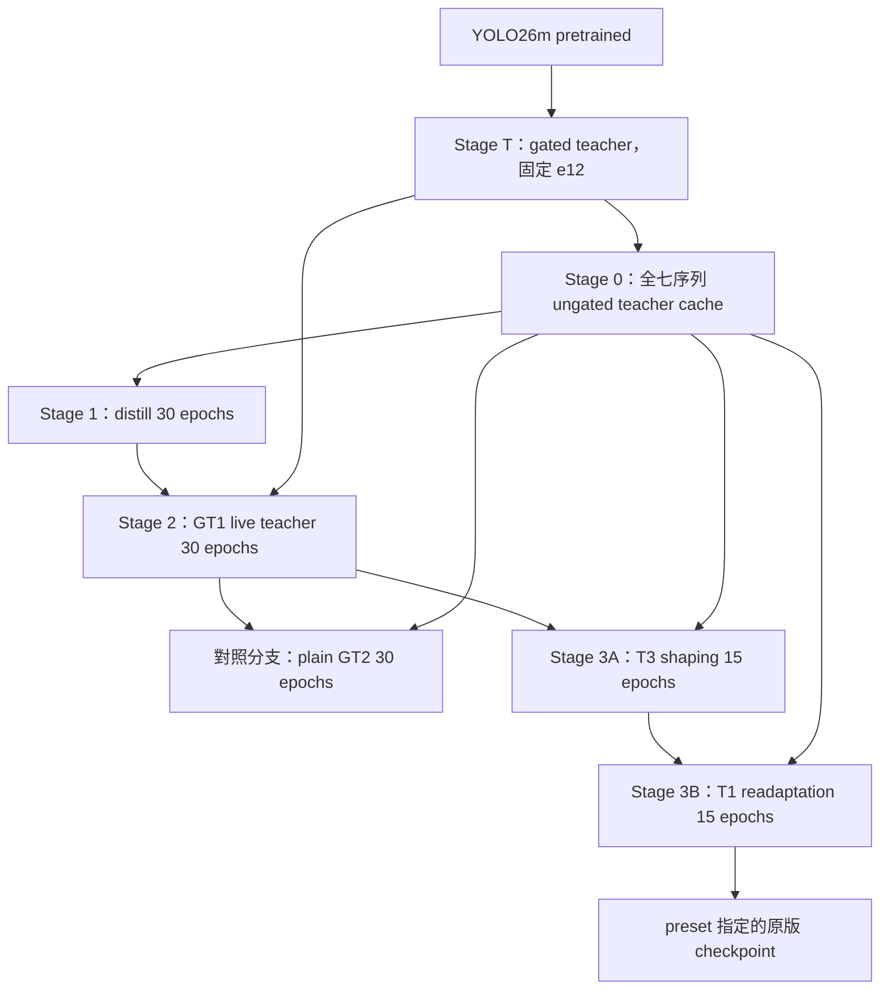

# 舊 Saccade YOLO26m 訓練規格與微調流程

整理日期：2026-10-29。範圍：**規格與流程文件**；依使用者確認，以舊庫
`mamba_whole_graph_m` preset 指定的原版 **YOLO26m＋Mamba T3→T1** 為主。
本次沒有搬移或重寫訓練程式、複製權重／資料集／cache，也沒有啟動訓練。

## 1. 模型身分與先說明的缺口

主線 checkpoint 是舊庫的
`runs/mamba_gt_yolo26m_v14replica_t3_t1/best.ckpt`，epoch 15，SHA-256
`a5a0e7091cd854ad68210ae4bbd43af73c7d3d098ea119f02ea65fab59c0676c`。
這裡的 **m 指 YOLO26m 的 backbone／neck 容量**，不是另一個 Mamba 尺寸。

| 項目 | 已確認的事實／待補內容 |
| --- | --- |
| 主線選擇 | 使用者指定 preset 原版 T3→T1；較晚的 `…_gpu_decode` 追加微調只列於 §8。 |
| 原版 cache | `runs/mamba_teacher_cache_yolo26m_v14replica` 本機缺失，歷史 inventory 亦記為 unavailable；目前不能逐檔重播原訓練。 |
| cache 重建 | 現存 nvJPEG cache 是另一份 artifact；目前 cache wrapper 預設也已改為 GPU decode。重建時須先固定解碼／resize 規格，不能只沿用路徑名稱。2026-10-30：T01 固定為 nvJPEG GPU decode＋float antialiased stretch，teacher、GT1 與全部 cache 同一路徑（[T01_TRAINING §2.1](T01_TRAINING.md#21-輸入前處理契約-t01-input1)）；舊 GPU cache 用的是無 antialias bilinear，與 T01 不同。舊流程的 cache 與 GT1 features 以 PyTorch 預設的 TF32 卷積計算，與嚴格 FP32 的部署 features 差約 1%；T01 改為 `fp32-strict`，manifest 記錄計算精度與儲存 dtype（[T01_TRAINING §2.2](T01_TRAINING.md#22-計算精度與儲存-t01-precision1)）。 |
| 選模 | 主線 `best.ckpt` 依 training loss 選取，metadata 標為 `diagnostic_train_loss`，不是獨立驗證集最佳模型。 |
| 實際部署 head | preset 同時指定固定 `mamba_head_26m.engine`；preset 指定的 `.ckpt` 與 engine 實際載入的 head 不能畫等號。2026-10-29 追加：其 sibling `mamba_head_26m.onnx` 的 65 個 initializer 全部對上 §8 的 `best_recall.ckpt`（epoch 11），不是 T1 主線；engine bytes 本身仍未歸屬（[evidence](../evidence/s01/2026-10-29/REPORT.md)）。 |
| v1 接入 | 2026-10-29 使用者決策：[DATAFLOW B03](DATAFLOW.md#11-由舊架構收斂的-v1-設計基線) 改以本文件的原版 m 架構為 v1 模型基線，部署 T=1。這只固定架構與 [scan 契約](SCAN_CONTRACT.md)；新 run 的起點、cache backend、split 與選模已由 [T01](T01_TRAINING.md) 在正式訓練前固定（2026-10-30）；主線 checkpoint 未被採為 v1 權重。S01／P01 狀態見 [MODEL_FEASIBILITY](MODEL_FEASIBILITY.md)。 |

## 2. 來源與證據層級

舊庫根目錄：`/home/ray/developer/ai/saccade`。本輪查核時 Git tracked files
乾淨，HEAD 為 `e48f3b39d5bfeb192a08d8a02cd2c04cf053bdd2`；本文件的來源連結
固定在該 revision。這是**整理時的 source 快照**，不是所有歷史訓練的原始
revision；teacher inventory 記錄的訓練 revision 為 `06e539ce2955…` 且 dirty。

| 來源 | 用途 |
| --- | --- |
| [m 容量對照 protocol][protocol]、[m 全鏈 runner][runner] | 階段、超參數、分支及 teacher e12 規則。protocol 前面的 s／e30 變體不併入本流程。 |
| [lineage inventory][lineage]、[角色宣告][roles] | artifacts、parent edges、實際 epochs、記錄的 args 與 cache 缺失。 |
| [distill trainer][distill]、[GT trainer][gt]、[dataset][dataset]、[training utilities][utils] | 文件未展開的 loss、資料篩選、optimizer、scheduler 與 resume 語義。 |
| [m preset][preset]、[comparison matrix][matrix] | preset checkpoint 與實際 head 載入方式、engine provenance 的限制。 |
| 本機 artifacts，2026-10-29 唯讀查核 | base／teacher／各段 `best.ckpt` 逐檔 SHA-256 與 CPU checkpoint metadata；GPU cache 僅查 manifest，未重新逐檔 hash 全 cache。 |

本輪沒有重新訓練、執行 detector／tracking 評估或驗證 engine 輸出。舊實驗成績
不移作 v1 驗收結果；下面記錄的是流程與產物身分。

## 3. 共用模型與資料規格

| 項目 | 原版 m 主線 |
| --- | --- |
| 預訓練起點 | `models/yolo/yolo26m.pt`；teacher 再做 MOT17 domain adaptation。 |
| Backbone／neck → head | P3/P4/P5，stride 8/16/32，640 輸入下空間尺寸 80²/40²/20²，channels **256/512/512**。s 的 128/256/512 不能直接套用。 |
| Mamba head | `d_model=128`、`d_state=16`、每尺度 `num_blocks=1`、`spatial_reduction=4`、四方向 Cross-Scan、PixelShuffle。 |
| 輸出 | 80 類 cls；`reg_max=1`，每位置直接回歸 4 個 box distances，不啟用 DFL。GT 的 pedestrian 映射到 detector class 0。 |
| 梯度範圍 | distill／GT1／plain GT2／T3／T1 均 `scan_stop_grad=true`；SSM 內部不學習，外圍 projection／gate／readout／upsampling／prediction head 學習。teacher 在 student stages 凍結。 |
| Temporal | distill／GT1 不含 temporal blocks；T3 加入，T1 保留權重但單幀 forward bypass。部署語義是 T=1，不承接跨幀 ModelState。 |
| 輸入 | RGB、CHW、float32 `/255`、stretch 到 640×640；不使用 letterbox。舊原版 teacher／GT1 用 CPU decode＋uint8 antialias resize，舊 GPU cache 用 nvJPEG＋無 antialias bilinear。T01 全鏈改用 nvJPEG GPU decode＋float antialiased stretch（[T01_TRAINING §2.1](T01_TRAINING.md#21-輸入前處理契約-t01-input1)）。 |
| 資料根目錄 | 舊庫 `datasets/MOT17/train/<sequence>/img1`、`gt/gt.txt`、`seqinfo.ini`。 |
| GT 篩選 | `conf==1`、MOT class 1 pedestrian、visibility ≥ 0.1；使用真實 GT boxes。 |
| 資料範圍 | `MOT17-02/04/05/09/10/11/13-SDP`，共 5316 frames；全部七個 sequence 參與訓練，**無 holdout**。 |
| Seed | 原 m 全鏈 `20260612`；不要套用其他 s 實驗的 seed 42。 |

`clip_len=T` 表示 clip 內 T 張連續影格；`clip_stride` 是 **clip 起點步長**。
例如 T=4、stride=8 是取四連續幀後跳過下一段四幀，不是 clip 內每八幀取樣。
cache 包含全序列不代表每個訓練 stage 都看過全部影格。

## 4. 完整依賴流程



**T3 的 parent 是 GT1；plain GT2 是平行對照，不是 T3 的前一站。**
各段使用 parent 的 `best.ckpt` warm-start，重新建立該段 optimizer／scheduler。
計畫的訓練長度與最後被選中的 checkpoint epoch 分別記錄，見 §6。

| 階段 | 輸入／監督 | Epochs | T／起點 stride | Batch／accum | LR | Warmup | `gt_ratio` |
| --- | --- | ---: | --- | --- | --- | ---: | --- |
| T：teacher | 原始 YOLO26m；GT detection＋gate 訓練 | 30 的 schedule，固定取 e12 | 2／2 | 4／1 | gate `1e-3`；YOLO `1e-5` | 0 | 0.5 |
| 0：cache | 同一 teacher e12；P3/P4/P5＋各尺度 cls/reg targets | 不訓練 | 逐幀覆蓋七序列 | 現行舊庫 cache builder 預設 8／不適用 | 不適用 | 不適用 | 不適用，`gate_input=null` |
| 1：distill | cache；模仿 teacher cls/reg | 30 | 1／1（args stride=0，effective=1） | 8／1 | `1e-3` | 5 | 不適用 |
| 2：GT1 | distill best；live teacher features＋真實 GT | 30 | 4／8 | 4／1 | `1e-4` | 5 | 0.5 |
| 對照：plain GT2 | GT1 best；cache features＋真實 GT | 30 | 4／8 | 4／1 | `1e-4` | 5 | 0 |
| 3A：T3 | GT1 best；加 temporal blocks；cache＋真實 GT | 15 | 3／6 | 4／1 | `1e-4` | 3 | 0 |
| 3B：T1 | T3 best；單幀再適應；cache＋真實 GT | 15 | 1／2 | 4／1 | `1e-4` | 3 | 0 |

Teacher 使用 30-epoch LR schedule，但流程**固定選 epoch 12**；不能改成只設
`epochs=12` 而聲稱等價，也不能把留下 e12 說成 teacher 已成功完成 30 epochs。
舊 runner 會在 teacher 非零退出但 e12 存在時繼續。

### Loss、更新與 gate 的意義

Distill 的目標是三個尺度的 `MSE(student_cls, teacher_cls)` 加
`MSE(student_reg, teacher_reg)`，不是直接對 P3/P4/P5 做 feature reconstruction。
cache 同時保存 FPN features 與 Detect cls/reg targets。

GT1／plain GT2／T3／T1 改用真實 GT 的 `v8DetectionLoss`＋TaskAlignedAssigner。
此主線 `reg_max=1`，有效項為分類 BCE 與 box CIoU；generic docstring 的
「DFL＋CIoU＋BCE」不能解讀為本配方啟用 DFL。T3 對 clip 的各個真實 GT 幀施加
detection supervision，沒有額外啟用 dual T1 loss 或 consistency loss。

`gt_ratio=0.5` 控制 live teacher 的前幀 GT gate feedback，不是將 GT loss 與
distillation loss 各混合 50%。cache 是 ungated features，GT trainer 的 cache
模式要求 `gt_ratio=0`，沒有 live gate feedback。

Student 使用 AdamW、weight decay `1e-4`、linear warmup＋cosine decay
（共用 scheduler 的最低 LR 比例 0.01）、gradient clipping 1.0。
Teacher 本段使用 gradient clipping 10，與 student 不同。

## 5. Cache 交接與重訓的適用範圍

重建 cache 的規格需記錄 teacher/base 的 SHA-256、明列七序列、640 stretch、
`gate_input=null`、float16 儲存，以及 decode／resize backend。每幀保存
P3/P4/P5 與 cls/reg targets；只含 FPN 的 legacy cache 不滿足現行 distill 入口。
GT cache stages 使用 features，supervision 仍來自 GT，不是 cache 裡的 pseudo-label。

目前缺原版 cache，故以下三種工作必須分清：

| 工作 | 所需起點與限制 |
| --- | --- |
| 重建原配方整條鏈 | base → teacher → 新 cache → distill → GT1 → T3 → T1；先固定 cache producer、訓練 source／環境與選模規則。這會產生新 artifacts，不宣稱原 checkpoint 逐位元重現。 |
| 重做 T3→T1 curriculum | 使用指定 GT1 parent 與固定 cache，重新跑 T3 15ep、T1 15ep；更換 cache 必須記為實驗差異。 |
| 從 preset T1 再微調 | 使用原版 T1 parent 開新 stage；屬追加微調，不等於重做原 T3→T1，也不自動包含 §8 的 GPU cache 設定。 |

本次確定的是主線身分與歷史流程；本文件不代填成已採納的新實驗。重建整條鏈的
新實驗為 [T01](T01_TRAINING.md)：起點、split、cache 後端（nvJPEG GPU decode）與
選模政策都在正式訓練前固定於該文件。

## 6. Checkpoint、warm-start 與選模

下列路徑均相對於**舊庫根目錄**；本機逐檔 hash 已與 inventory 交叉核對。
表中的 epoch 是各 stage 自己的編號，不是全鏈累積 epoch。

| 角色 | Artifact | 實際選取 epoch | SHA-256 |
| --- | --- | ---: | --- |
| Base | `models/yolo/yolo26m.pt` | — | `401cea9ab23ad19246ff7744859816bc599f350e93c9dd30367b6f0a0745d0b7` |
| Teacher | `runs/gated_det_yolo26m_v14replica/epoch_0012.ckpt` | 12（protocol 固定） | `5f1cb461cb063788ee8fb933340055add4b4003d7c945ef14f676a5a8c3bea06` |
| Distill | `runs/mamba_distill_yolo26m_v14replica/best.ckpt` | 30 | `5bc14397102ee71763b6b260e4f43a79a797f4a3de99e64422dd53597a5ee56c` |
| GT1 | `runs/mamba_gt_yolo26m_v14replica_stage1/best.ckpt` | 29 | `fb8434556a2a14c84b8f1c6d00bc4734bfb2897d5fbd73e01ddbc110078068de` |
| Plain GT2 對照 | `runs/mamba_gt_yolo26m_v14replica_final/best.ckpt` | 29 | `1960e28f8924e5918c4ee3989abc583a390f63f8257017dcb4cc85fe30b00a84` |
| T3 | `runs/mamba_gt_yolo26m_v14replica_t3/best.ckpt` | 14 | `ca41aa449fe5fd5488b4aff3863d312907eb83ed821606eb0da46dd069782d2d` |
| **T1 主線** | `runs/mamba_gt_yolo26m_v14replica_t3_t1/best.ckpt` | **15** | `a5a0e7091cd854ad68210ae4bbd43af73c7d3d098ea119f02ea65fab59c0676c` |

Distill 的 `best.ckpt` 固定取最低平均 training loss；原 runner 的各 GT stage
顯式使用 `--best-by train-loss --save-every 5`。主線 T1 metadata 記錄
`selection.status=diagnostic_train_loss`、`holdout_seqs=[]`。
`best.ckpt`、`latest.ckpt`、定期 `epoch_XXXX.ckpt` 的角色不同，交接時不能互換。

`--mamba-ckpt` 是新 stage 的模型 warm-start，不沿用 parent 的 optimizer／LR
進度。GT 的 `--resume` 則恢復 student、optimizer、scheduler 與 epoch；改 LR／
重設 schedule 使用 `--resume-reset-optimizer`，須另記錄。現行 GT checkpoint
沒有保存完整 RNG state，固定 seed 也不強制所有 kernel 決定性，不能稱逐位元
exact continuation。不要直接以其他 trainer 的 resume 保證推論本入口。

## 7. 評估與重跑入口

舊庫全鏈入口為 [run_v14replica_yolo26m.sh][runner]；這是歷史流程定位，不是
現在可以無差異執行的 replay 承諾。重跑前須處理：

| 現行入口的行為 | 對規格的影響 |
| --- | --- |
| [cache builder][cache-builder] 預設 `GPU_DECODE=1` | 直接重跑會製作 GPU decode cache；不可默認它就是缺失的原 cache。 |
| runner 的 `SEQS` 只傳給 cache／distill | teacher 與 GT stages 仍使用預設全部 SDP；只改此變數不能實現全鏈 holdout。 |
| cache builder 使用 `.venv/bin/python` | 外層 runner 的 `PYTHON` 不會自動傳入此步，環境身分要另核對。 |
| runner 尾段使用一般 `mamba_whole_graph` preset 加 m overrides | 它不等於目前 `mamba_whole_graph_m` 的完整 tracker／head 設定；舊尾段命令不能直接充當新 checkpoint 的固定評估契約。 |
| m preset 指定固定 TRT head | 比較不同 checkpoint 時，舊庫需顯式 `--no-mamba-trt`，才讓被比較的 checkpoint head 實際執行。 |

Detector 檢查沿用 MOT17-02 的 size-binned recall，thresholds
`0.001,0.10,0.25`，觀察 all／4–8px／8–16px recall 與 FP/FN；tracking
報告 HOTA、IDF1、MOTA、DetA、AssA、IDs、FP/FN，速度與精度分開。
因主線已看過全七序列，02 和七序列 tracking 都是 in-domain diagnostics，
不是獨立 holdout／test-server 成績。

例如，舊庫對**原主線 checkpoint** 的明確 head 選擇可寫為以下命令；這是文件
示例，本輪未執行，也未驗收其目前環境可跑：

```sh
# 工作目錄：/home/ray/developer/ai/saccade
.venv/bin/python scripts/eval/mot17.py \
  --preset mamba_whole_graph_m --no-mamba-trt \
  --mamba-ckpt runs/mamba_gt_yolo26m_v14replica_t3_t1/best.ckpt \
  --detector SDP \
  --sequences MOT17-02-SDP,MOT17-04-SDP,MOT17-05-SDP,MOT17-09-SDP,MOT17-10-SDP,MOT17-11-SDP,MOT17-13-SDP \
  --output results/retrain_spec_m_t3t1_reference
```

新 run 應固定 source revision／dirty diff、完整 command／resolved args、seed、
明列 train／selection sequences、base／teacher／parent hashes、cache manifest
及內容身分、實際執行的 head／backbone 身分、環境與選模報告。若新實驗改採
held-out selection，需另定規格並讓 teacher → cache → distill → GT 全鏈使用
一致 split；不是只在最後 GT 階段排除 02。

本機舊環境 metadata 查得 Python 3.12.13、torch 2.11.0、torchvision 0.26.0、
ultralytics 8.4.37、numpy 2.4.4；這是**整理時的安裝狀態**，未證明等於歷史
訓練環境或可完成新訓練。整理時 source 中的 [uv.lock][lock] SHA-256
`d06c1db0da58091d4cd2a5a08b0145dc66af9b70ba40b0ca87aeac7242621d3c`。

## 8. 較晚的 GPU-cache 追加微調：只作差異備註

`runs/mamba_gt_yolo26m_v14replica_t3_t1_gpu_decode/best.ckpt` 是以原版 T1
為 parent，使用新 nvJPEG cache **再跑 T1 15 epochs**；batch 4、accum 1、
LR `1e-4`、warmup 3、T1／stride 2、`gt_ratio=0`、seed `20260612`。
檔案 mtime 顯示原版為 6/14、追加版為 7/6，僅作年代線索。

| Artifact | 已核實身分 |
| --- | --- |
| 追加 `best.ckpt` | epoch 15；SHA-256 `477fe1ab41bd7948028fd6a84f7ef63f6f5af4a70849ff352199d7d82fe6f3f9`。 |
| 同 run `best_recall.ckpt` | epoch 11；SHA-256 `dc186f546a9e33afe3566a07346f2cf5e42735fcac7274cb8f362355ac912626`；本輪未核實其完整選取程序，不由檔名認定它是推薦模型。 |
| GPU cache | `runs/mamba_teacher_cache_yolo26m_v14replica_gpu_decode/manifest.json`；SHA-256 `035eb90eb16012db55d7615f18e6d50d8967e3abf9304a5a2e7eabd825137abd`。 |
| Manifest 宣告 | `mamba-teacher-cache-v2`、complete、5316 frames、float16、stretch 640、FPN 256/512/512、`gate_input=null`、`decode_backend=torchvision_nvjpeg`；base／teacher hashes 與 §6 相符。 |

此處 GPU decode 發生在 **cache 製作**；追加訓練的 args 為 `gpu_decode=false`，
因為它讀 cached features。它比原版多一段訓練，不能當同起點／同 budget 的
CPU-vs-GPU decode A/B；[comparison matrix][matrix] 也將此比較標為 blocked。
「比較晚」不代表品質較佳，依使用者決定不把它當此次主線。

[protocol]: https://github.com/raylei50653/saccade/blob/e48f3b39d5bfeb192a08d8a02cd2c04cf053bdd2/docs/modules/detection/mamba-v14-replication-protocol.md#L423-L443
[runner]: https://github.com/raylei50653/saccade/blob/e48f3b39d5bfeb192a08d8a02cd2c04cf053bdd2/scripts/train/temporal_yolo/run_v14replica_yolo26m.sh
[lineage]: https://github.com/raylei50653/saccade/blob/e48f3b39d5bfeb192a08d8a02cd2c04cf053bdd2/docs/research/training/training_lineage_inventory.md#L179-L259
[roles]: https://github.com/raylei50653/saccade/blob/e48f3b39d5bfeb192a08d8a02cd2c04cf053bdd2/scripts/provenance/training_lineage_roles.json#L324-L337
[distill]: https://github.com/raylei50653/saccade/blob/e48f3b39d5bfeb192a08d8a02cd2c04cf053bdd2/scripts/train/temporal_yolo/train_mamba_head.py
[gt]: https://github.com/raylei50653/saccade/blob/e48f3b39d5bfeb192a08d8a02cd2c04cf053bdd2/scripts/train/temporal_yolo/train_mamba_gt.py
[dataset]: https://github.com/raylei50653/saccade/blob/e48f3b39d5bfeb192a08d8a02cd2c04cf053bdd2/src/saccade/perception/temporal_yolo/dataset.py
[utils]: https://github.com/raylei50653/saccade/blob/e48f3b39d5bfeb192a08d8a02cd2c04cf053bdd2/src/saccade/perception/temporal_yolo/training_utils.py
[preset]: https://github.com/raylei50653/saccade/blob/e48f3b39d5bfeb192a08d8a02cd2c04cf053bdd2/configs/presets/mamba_whole_graph_m.yaml
[matrix]: https://github.com/raylei50653/saccade/blob/e48f3b39d5bfeb192a08d8a02cd2c04cf053bdd2/docs/research/training/training_comparison_matrix.md#L1072-L1100
[cache-builder]: https://github.com/raylei50653/saccade/blob/e48f3b39d5bfeb192a08d8a02cd2c04cf053bdd2/scripts/train/temporal_yolo/build_mamba_teacher_cache.sh
[lock]: https://github.com/raylei50653/saccade/blob/e48f3b39d5bfeb192a08d8a02cd2c04cf053bdd2/uv.lock
