# Saccade v1：追蹤流程與這一輪的結果

## 1. 先看目的、流程與結果

### 1.1 希望解決的問題

一張畫面裡把人框出來，只回答了「人在哪裡」。影片追蹤還要處理下一個問題：**下一張畫面中的這個人，是否仍是剛才那個人？** 人會移動、互相遮住，攝影機也可能晃動；這些變化都會讓身份接續變難。

Saccade v1 把讀取畫面、找人、估計相機位移、接續 ID 和輸出結果接成一條原生 GPU 流程。影像、模型張量與追蹤狀態留在 GPU，CPU 負責輸入、排程與取回結果。這樣設計的目的是減少中間資料來回搬移，讓偵測與追蹤能在同一套流程裡持續工作。Runtime 使用 C++／CUDA／TensorRT，不需要 Python，也沒有額外使用 ReID 外觀模型。

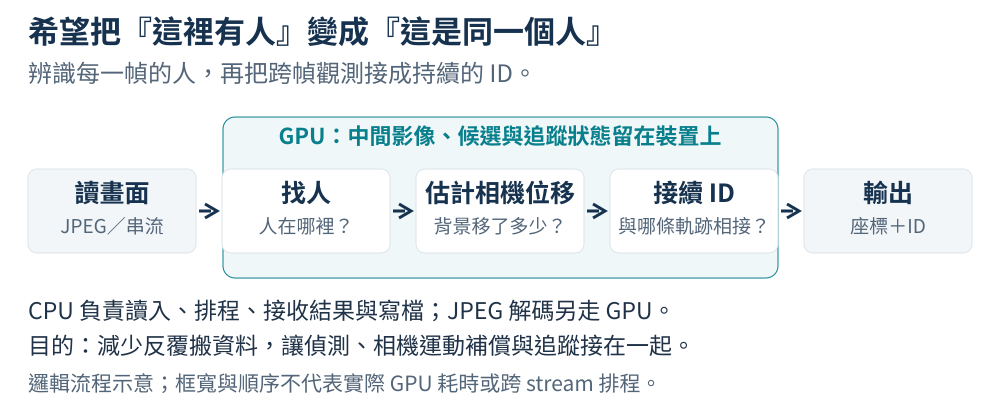

相機位移補償可以想成先估計「整張背景往哪裡移」，再把它放進人的位置預測，減少攝影機移動對關聯的干擾。這只是流程的目的；補償後能否讓某個場景追得更穩，仍要看結果。

下圖取自既有 MOT17-10 展示影片的三個影格。畫面中的 ID 71 是系統實際輸出的編號；把人框出來之後，追蹤器還要在下一幀接續這個編號。這裡展示輸出如何閱讀，沒有用三張畫面判定整段追蹤是否正確。

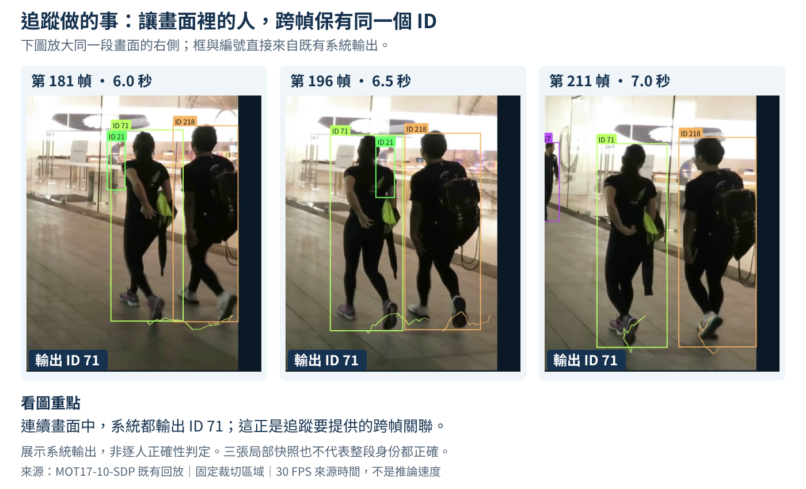

### 1.2 n 和 n+1 為什麼能交錯

n 是上一張畫面，n+1 是下一張。**偵測路徑可以先往下一幀走，上一幀繼續完成追蹤。** 這是讓連續處理更有效率的排程方式；追蹤狀態仍然逐幀依序提交。

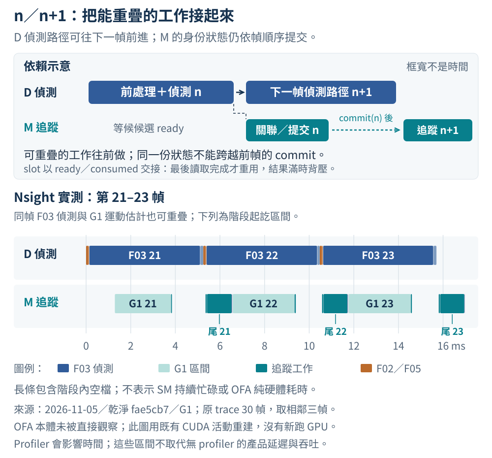

這裡要分開看兩種重疊：同一幀的 G1／運動預測可以與偵測同時執行；下一幀的偵測路徑，也可以與上一幀的 mask／關聯／提交尾端交錯。**能交錯的工作，以實際 trace 中的階段為準；M(n+1) 仍要接在 M(n) 的 commit 後面，buffer 也要等讀完才能重用。**

排除初始化與第一次 Execute 後，完整 F06 在 **28／28 幀**落入同幀 F03 的時間窗；**27／27 組**相鄰穩態影格都有跨幀 CUDA 活動交集，平均約 **0.94 ms**。主要交集為 F03(n+1) 與上一幀 mask／追蹤尾端，另有少量 F05；F02、producer、F04 在這批交集為零。起訖包覆區間的平均交集為 1.129 ms，實際 kernel 活動聯集交集為 0.937 ms，兩者分開保存。

下半圖重算 2026-11-05、乾淨 `fae5cb7` 的 G1／HR 30 幀原始 trace，未新增 GPU capture。圖中的階段起訖包含空檔，並非全部時間都在算；OFA 本體沒有被直接量到，profiler 時間也不替代無 profiler 的產品延遲。原始 SQLite 的壓縮副本、[重算結果](../../evidence/report1/2026-11-12-schedule-trace/summary.json)與[方法](../../evidence/report1/2026-11-12-schedule-trace/analyze.py)一併保留。

### 1.3 現在做到哪裡

這一輪已經能從 JPEG 序列一路產生偵測、相機位移、追蹤 ID 與 MOT 輸出，也有可逐幀觀看的[技術展示台](../demos/report1/index.html)。閱讀結果時，可以先記住三件事：

- **完整流程已接通。** 後面的架構與一致性檢查說明它如何運作，以及哪些範圍已經驗證。
- **品質有場景差異。** 現行 HR Mamba 在未參與訓練的 MOT20 與 MOT17-02 較高，在 DanceTrack／PersonPath22 則較低；MOT17 的合併分數含本地訓練序列，不能直接當成泛化。
- **較複雜的模型有成本。** 本機受控比較中，微調 YOLO26m 的平均延遲較低、吞吐較高；要把品質與速度一起看。

### 1.4 多了這些設計，在哪些資料上有幫助

下圖把官方預訓練 YOLO26m、微調 YOLO26m 和現行 HR Mamba 放在同一張圖裡。三方接入本專案共用的前後處理與追蹤流程，每個模型各跑 **156 段、135,503 幀**。先看同一個資料集內的差別，跨資料集的分數高低不直接代表場景難度排名。

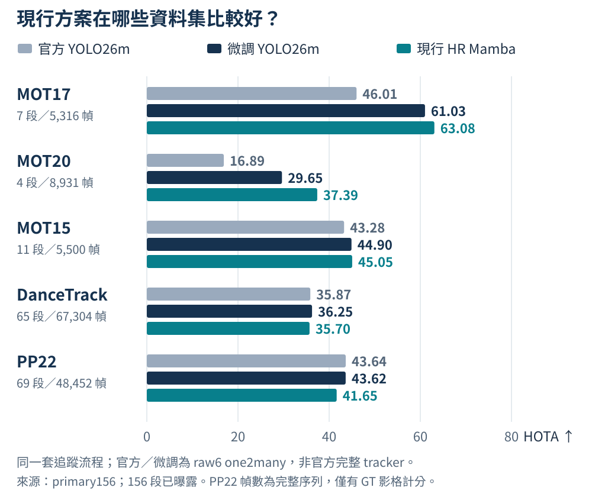

相對微調 YOLO26m，HR Mamba 在 MOT17 的合併 HOTA 增加 **2.053 個百分點**，MOT20 增加 **7.742**；DanceTrack 下降 **0.543**，PersonPath22 下降 **1.974**。MOT15 合併只增加 **0.153**，它的 moving 子群仍退步。

**MOT17 的合併分數含訓練序列。** 七段中的 04／05／09／11／13 是兩個本地模型的訓練序列，10 用來選模，只有 02 沒有參與訓練。02 的官方／微調／HR HOTA 為 36.761／37.710／40.565，HR 比微調高 **2.855**；選模用的 10 則是 HR 低 **1.332**（50.869 對 52.200）。官方到微調的 MOT17 合併差距約 15.02 個百分點，在 02 只剩 0.949，大部分來自訓練序列。MOT20 沒有參與兩個本地模型的訓練：微調版比官方高 12.756，HR 再高 7.742，比 MOT17 合併值更能代表跨資料集表現；但這批資料先前都已曝光，仍不是盲測。逐段分數見[逐段 CSV](../../evidence/model-comparison/2026-11-11-yolo26m-primary156/bundle/metrics/per-sequence.csv)，訓練分工見[訓練來源](../../evidence/model-comparison/2026-11-11-yolo26m-primary156/bundle/training-provenance.json)。

把五個資料集再拆成七個既定群組，可以看到合併分數容易遮住的差異。下圖以微調 YOLO26m 為零點：往右表示 HR 較高，往左表示 HR 較低。

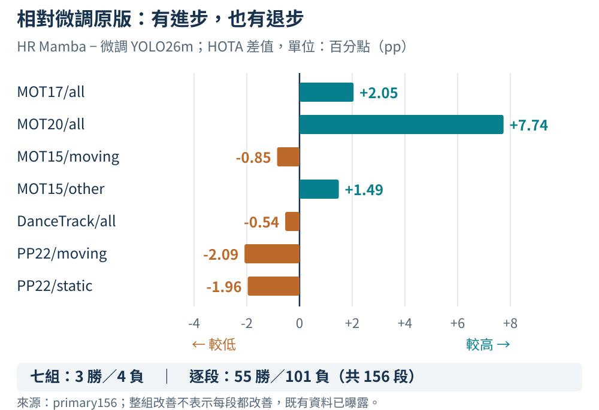

七個群組是 **3 組增加、4 組下降**；逐段看則是 **55 段增加、101 段下降**。MOT20 的四段 HOTA 都增加，但不能因此推論身份切換全面變少：其合併 IDSW 仍從微調版的 2,401 次增加到 HR 的 3,754 次。這些結果提示我們，偵測覆蓋、關聯品質與身份穩定度需要一起檢查。

### 1.5 為這些品質差異，多付出了多少時間

速度比較只量了 MOT17-10 和 MOT17-02 的前 140 幀，不能當作五個資料集的完整效能。每次先暖機 20 幀，再量 120 幀；每個模式有四次 fresh sessions，JPEG 預載，排除讀檔、初始化、暖機與寫檔。

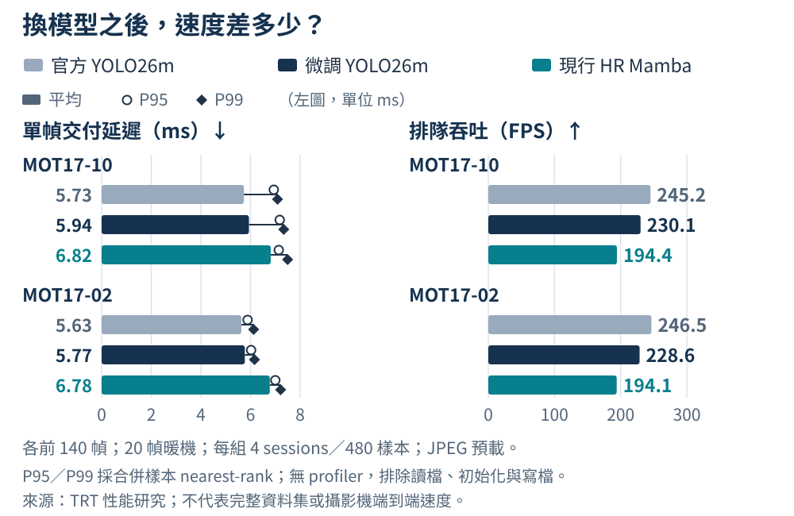

例如 MOT17-10，微調 YOLO26m 的單幀平均交付延遲是 **5.938 ms**，HR Mamba 是 **6.816 ms**；排隊處理時的吞吐是 **230.123 FPS** 與 **194.417 FPS**。兩個場景合看，HR 的平均延遲增加約 **14.79–17.42%**，吞吐下降約 **15.13–15.52%**。因此這一輪呈現的是資料集相關的品質與成本取捨；速度優先時，微調 YOLO26m 在這些量測中較有效率。

**P95／P99 看較慢的尾端。** 約 95%／99% 的這批樣本不超過該延遲；它們由四次 session 合併的 480 筆暖機後樣本取 nearest-rank，不是平均各次 run 的分位數。Single 是立即接收，queued 另含在途等待，以下均為 ms。

<!-- BEGIN GENERATED LATENCY PERCENTILES -->

| 序列 | 模型 | Single P95 | P99 | Queued P95 | P99 |
| --- | --- | --- | --- | --- | --- |
| MOT17-10 | 官方 YOLO | 6.938 | 7.088 | 16.954 | 17.317 |
| MOT17-10 | 微調 YOLO | 7.178 | 7.339 | 19.908 | 20.529 |
| MOT17-10 | HR Mamba | 7.139 | 7.494 | 21.309 | 21.748 |
| MOT17-02 | 官方 YOLO | 5.882 | 6.126 | 16.761 | 16.994 |
| MOT17-02 | 微調 YOLO | 6.024 | 6.160 | 19.984 | 20.255 |
| MOT17-02 | HR Mamba | 6.999 | 7.214 | 21.216 | 21.539 |

<!-- END GENERATED LATENCY PERCENTILES -->

Queued 在兩個場景的 HR P95／P99 都較高；MOT17-02 的 single P95／P99 也是 HR 較高。MOT17-10 的 single 尾端與微調版相差不到 0.2 ms（P95 7.139 vs 7.178、P99 7.494 vs 7.339 ms）；GPU 時脈未鎖定、每組只有 480 筆，這個差距不足以判斷誰的尾端較穩。480 筆的 P99 是排序第 476 筆，超過它的樣本最多四筆，仍只描述本次樣本。

本次從原 48 份逐幀 CSV 獨立核對全部 12 組 P95／P99，與保存摘要相同，沒有重新測速；原統計稽核核對 mean／P95，本次補核 P99，見 [核對收據](latex/report1/latency-percentiles-audit.json)。

「一秒能處理多少幀」和「這一幀等多久拿到結果」是兩種問題。讓多幀一起在途可以提高吞吐，也會增加等待；**194 FPS 不能換算成每幀只等約 5 ms**，更不能當作攝影機到畫面顯示的完整延遲。

### 1.6 這些指標怎麼讀

| 指標 | 直觀上在看什麼 | 方向 |
| --- | --- | --- |
| HOTA | 人找得好不好，以及前後幀身份接得好不好 | 越高越好；它不是「追對百分之幾的人」 |
| IDF1／IDSW | 身份是否持續對得上／發生幾次身份切換 | IDF1 越高越好；IDSW 越少越好，兩者需一起看 |
| P95／P99 | 約 95%／99% 的這批樣本在多少時間內返回，呈現慢尾端 | 越低越好；不是最慢 5%／1% 的平均 |
| Single latency | 提交一幀到呼叫端收到該幀結果，要等多久 | 越低越好；這裡排除讀檔與初始化 |
| Queued FPS | 多幀持續處理時，整段平均每秒完成多少幀 | 越高越好；不代表個別幀的等待時間 |

這些比較沿用已完成的研究，沒有新增推論、計分或調參。資料已在先前研究中曝光；官方／微調版採 raw6 one2many 接共用 tracker，並非官方預設 one2one 完整流程。數值 screen 的既有 FAIL、完整 session sanitizer 的 OPEN 與部署預設均保留。這次數字不能單獨證明 Mamba 架構的效果，也不能作為未見場景的品質承諾。

結果來源：[五資料集完整分數](../../evidence/model-comparison/2026-11-11-yolo26m-primary156/bundle/metrics/summary.json)、[逐段與分組稽核](../../evidence/model-comparison/2026-11-11-yolo26m-primary156/bundle/audits/scoring-audit.json)、[受控速度比較](../../evidence/model-comparison/2026-11-11-yolo26m-trt-performance/REPORT.md)。程式基準與完整設定見 §2，架構與同步見 §3–§4，測時定義與歷史結果見 §5–§8，完整品質表與比較限制見 §9.2。2026-11-12 本次修訂只調整說明方式與圖表。

[圖解 PDF](latex/report1/report.pdf)採相同閱讀順序；原本完整的 [v1.1 技術 PDF](latex/report1/technical-reference-v1.1.pdf)另存保留。圖表與實際影格的來源收據分別為 [story-figures.json](latex/report1/story-figures.json) 與 [example-sources.json](latex/report1/example-sources.json)。

## 2. 固定版本、部署與證據身分

### 2.1 報告版本與執行設定

| 項目 | 固定內容 |
| --- | --- |
| 報告 commit | `3cbaa518f0dc37d691404e95ed85c0109c81130d` |
| Commit 主旨 | `Close out first report baseline and shared weight paths` |
| 部署模型 profile | `hr-1280x768`，batch 1，stretch resize |
| Engine SHA-256 | `8292cc233019d08f1b1b6cfbc12f1fe1644f66f2164fd8f50a69b660a7817876` |
| 精度 | TensorRT FP16 tactics；模型 input、raw outputs、scan plugins 與 tracker 狀態維持 FP32 |
| GMC | G1 NVOFA，`v1-motion/2`；SLOW、grid 4、cell 8 |
| 排程 | D detect stream＋有序 M main stream；pipelined 模式；CUDA Graph ON |
| API ring 預設 | candidates 2 格、motion 2 格、results 4 格 |
| 可選追蹤設定 | `nsa_enabled=false`、`measurement_box=false` |
| 輸出 | 固定 ResultPacket；JPEG sequence 使用離線 `v1-mot/1` 定稿 |
| 報告基準的交付紀錄 | 本機 commit；原收尾未 push、未跑遠端 CI |

「部署主線採 HR」與「所有 API／CLI 的無參數預設都是 HR」是不同敘述。基準的 `kDefaultModelProfile`、`TrackingSessionConfig`、`track_sequence` 仍以 `t01-640x640` 為初始 profile；JPEG 主線須傳入 `--profile hr-1280x768` 或等價 resolved config。`track_stream` 才自行預設 HR，並選一格 result ring、逐幀提交後立即接收。參見 [model_profile.hpp](../../include/saccade/model_profile.hpp)、[tracking_session.hpp](../../include/saccade/tracking_session.hpp)、[track_sequence.cpp](../../tools/track_sequence.cpp)、[track_stream.cpp](../../tools/track_stream.cpp)。

### 2.2 量測環境與適用範圍

主要歷史效能證據使用 NVIDIA GeForce RTX 5070 Ti Laptop GPU、WSL2、driver 617.42、CUDA 13.4.92、TensorRT 10.16.1.11。資源盤點另記錄 46 SM、SM 12.0、1 個 asynchronous copy engine，以及 AMD Ryzen 9 8940HX（16 cores／32 threads）。這些是原量測環境紀錄，本稿未重新探測硬體。

GPU lock 用來避免同專案的量測同時執行；原報告沒有鎖定 clocks。筆電溫度、功率、時脈、檔案快取與執行順序均可能影響時間；結果只支持原記錄的裝置、engine、SDK、資料與入口。環境細節見 [clean-performance](../../evidence/f02-f03/2026-11-05-clean-performance/REPORT.md) 與 [resource-schedule](../../evidence/resource-schedule/2026-11-04/REPORT.md)。

### 2.3 歷史證據與報告基準的關係

| 證據 | 受測來源 | motion | 本稿用途 |
| --- | --- | --- | --- |
| M4／P01 | `cad5298` | `v1-motion/1` | 核心交付、身分鏈、首次 held-out 評估 |
| clean F02／F03 整合 | `23ade53` | `v1-motion/1` | 加速後正確性、七序列 21/21 輸出相同 |
| clean F02／F03 ABBA | `f4865cd` → `23ade53` | `v1-motion/1` | 有控制的效能比較、逐幀延遲分位數 |
| 資源／排程盤點 | `865bb10`＋當時修改，dirty | `v1-motion/1` | 分階段歸因、queued 交付延遲、ring 深度觀測 |
| G1 整合驗收 | 乾淨 `fae5cb7` | `v1-motion/2` | 現行 motion 的全路徑結果、吞吐與間接 OFA 重疊證據 |
| NSA v2 正式驗收 | 乾淨 `527ffe5` | `v1-motion/2` | 可選功能正確性、預設 OFF 回歸、較新的吞吐紀錄 |
| 第一輪版本收尾 | `3cbaa518f0dc` | 預設 `v1-motion/2` | 本稿架構與版本固定點、CPU／路徑核對 |

基準內保存早期證據不代表所有實驗在該基準重新執行。[第一輪收尾紀錄](../history/2026-11-11-first-report-baseline.md)明列當次沒有新增 GPU 推論、品質或效能實驗。

## 3. 系統架構

### 3.1 JPEG 主線：資料流與硬體責任

下圖按基準的 G1 實作重繪。F01 的 nvJPEG backend 與可選影片入口的 NVDEC 是不同路徑；F05 從原圖 RGB 產生光流用灰階影像，並非從模型 resize 後的 tensor 取得。

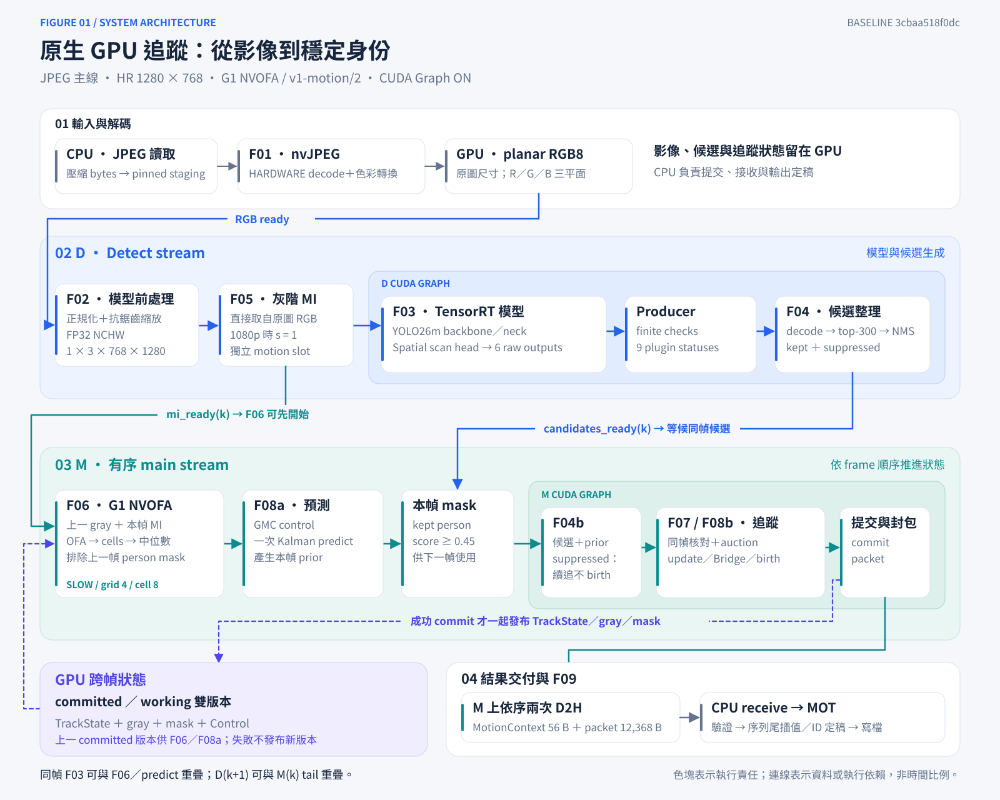

[開啟系統架構 SVG](assets/report1-3cbaa518f0dc/system.svg) · 可縮放與編輯的純向量圖。

<details>
<summary>查看 Mermaid 依賴對照</summary>

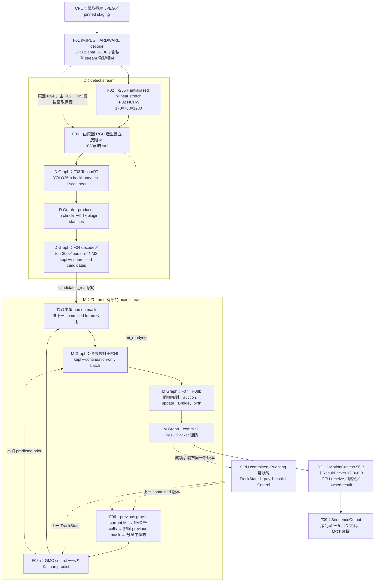

</details>

圖中的 Graph 標籤表示 capture 範圍；跨 stream 的 ready／consumed、F06、predict、mask 與 D2H 仍由 session 排程。MotionContext 與 ResultPacket 的兩次 D2H 都在 M tail 之後、同一 M stream 上依序提交，再 record 同一個 host result 完成事件。

架構依據：[tracking_session.cpp](../../src/tracking_session.cpp)、[flow_motion.cu](../../cuda/flow_motion.cu)、[TRACKING §20](../TRACKING.md#20-v1-motion2ofa-全域光流-gmc-整合2026-11-04-規格實作前固定)。[DATAFLOW](../DATAFLOW.md) 的部分主圖仍保留早期 PCR／cuFFT 設計；其 MI／SPEC／MotionState 描述已由 TRACKING §20 取代，本稿沒有將舊 FFT 圖當成現行 G1 架構。

### 3.2 F03 模型與資料形狀

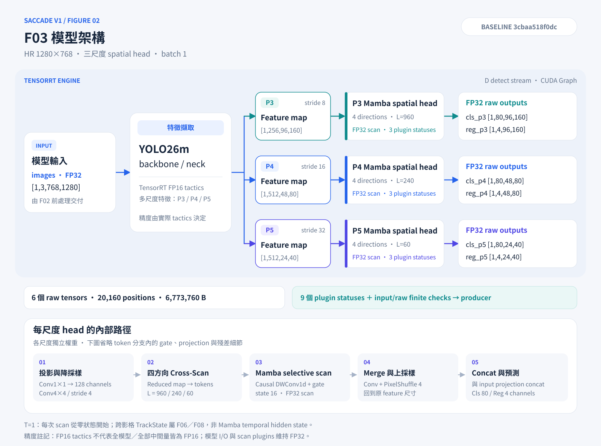

[開啟模型架構 SVG](assets/report1-3cbaa518f0dc/model.svg)。

<details>
<summary>查看 Mermaid 依賴對照</summary>

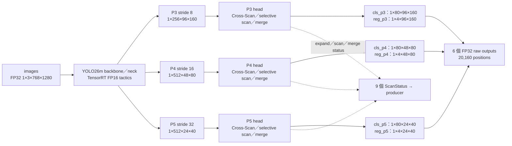

</details>

這是資料介面層級的模型圖，head 方框內尚有 projection、卷積、activation 與殘差等操作，圖中沒有逐層展開。FP16 是 engine 的 tactics 模式，不表示 selective scan、所有中間張量或 tracker 都改成 FP16。實際 I/O shape、binding 與 plugin 契約由 [model_profile.hpp](../../include/saccade/model_profile.hpp)、[head_trt_network.cpp](../../src/head_trt_network.cpp)、[model_trt_network.cpp](../../src/model_trt_network.cpp) 定義；部署精度見 [TRACKING §16](../TRACKING.md#16-d2hr-部署改用-fp162026-11-03-使用者核准)。

HR 輸入含 2,949,120 個 FP32 元素，占 **11,796,480 B（11.25 MiB）**。六個 raw outputs 共 `84×20,160 = 1,693,440` 個 FP32 元素，占 **6,773,760 B（6.460 MiB）**。這是張量 payload 大小，不是每幀 host-device 傳輸量，也不含 TensorRT workspace／中間量。

每尺度 head 先以 Conv1×1 投影成 128 channels，再以 Conv4×4／stride4 降採樣；P3／P4／P5 的 reduced maps 為 24×40、12×20、6×10，四方向 Cross-Scan 的序列長度分別為 960、240、60。Mamba 分支包含 causal depthwise Conv1d、SiLU、state=16 selective scan、gate、output projection 與 token 殘差；merge 後經 Conv／PixelShuffle4 回到原 feature 大小，與 input projection concat，再分 cls／reg 兩支。三尺度各有獨立 weights，沒有額外跨尺度 head 邊。

此 head 為 **T=1 spatial 路徑**，每次 scan 從零初始狀態開始；不把它描述成跨影格保留 Mamba hidden state 的 temporal tracker。跨影格追蹤狀態屬於 F06／F08／Control。細節見 [HEAD_TRT](../HEAD_TRT.md) 與 [head_trt_network.cpp](../../src/head_trt_network.cpp)。

### 3.3 主要階段與數值責任

| 階段 | 輸入 → 輸出 | 執行位置／責任 |
| --- | --- | --- |
| F01 | 壓縮 JPEG → 原圖 planar RGB8 | CPU staging、nvJPEG backend；RGB 留在 GPU |
| F02 | RGB8 → `/255`、stretch resize 的 FP32 NCHW | D；HR tile fusion 僅分派 1920×1080→1280×768，其他 shape 保留通用路徑 |
| F05 | 原圖 RGB8 → NVOF 灰階 MI | D；`s=max(1,ceil(W/1920),ceil(H/1080))`，1080p s=1，4K s=2 |
| F03 | images → P3/P4/P5 六個 cls／reg outputs | D Graph；TensorRT backbone／neck＋自訂 scan head |
| producer | input／raw finite checks＋9 statuses → aggregate status | D Graph；防止錯誤輸出被當成成功觀測 |
| F04 | raw → 至多 300 筆合法 person pool，含 kept／suppressed | D Graph；score≥0.001、全類別 top-300 後篩 person、NMS IoU>0.5；座標映回原圖、無 clipping |
| F06 | 上一 committed gray／mask＋MI(k) → `(tx,ty)` | M 排序；NVOFA 固定功能引擎＋CUDA reduction，非 cuFFT |
| F08a | 前次 TrackState＋GMC → 本幀 PredictedState／Prior | M；一次 control 與 constant-velocity Kalman predict |
| mask | 本幀 kept person 候選 → working mask | M、Graph 外；class 0、score≥0.45，供下一幀排除前景 |
| F04b | candidates＋本幀 predicted prior → DetectionBatch | M Graph；kept score≥0.05；continuation-only score≥0.10、prior IoU≥0.30、最多 50 筆、不允許 birth |
| F07／F08b | 同幀核對 → staged association／update／Bridge／birth | M Graph；FP32 決定性數學、穩定 tie-breaks；不使用 ReID |
| commit／packet | working state → committed state＋固定封包 | M Graph；失敗時不發布新狀態，封包保留首次錯誤 |
| F09 | owned packets → 最終 MOT | CPU；JPEG sequence 有序列尾插值，與即時 packet 交付時點不同 |

G1 的 OFA grid 為 4；每個 cell 由 2×2 個 grid-4 向量逐分量取中位數，對應 OFA 影像 8×8 像素。全域估計再對**上一 committed mask 以外**的 cells 分別取 x、y 中位數，乘回縮小倍率 s；不足 8 個 cells 時 rejected、位移為 0。它不是 trimmed mean、cost-weighted mean、局部仿射或單應性模型，也沒有使用 hints／cost／ROI。參見 [TRACKING §20.2–§20.5](../TRACKING.md)。

## 4. 並行、所有權與結果交付

### 4.1 單幀依賴與可重疊部分

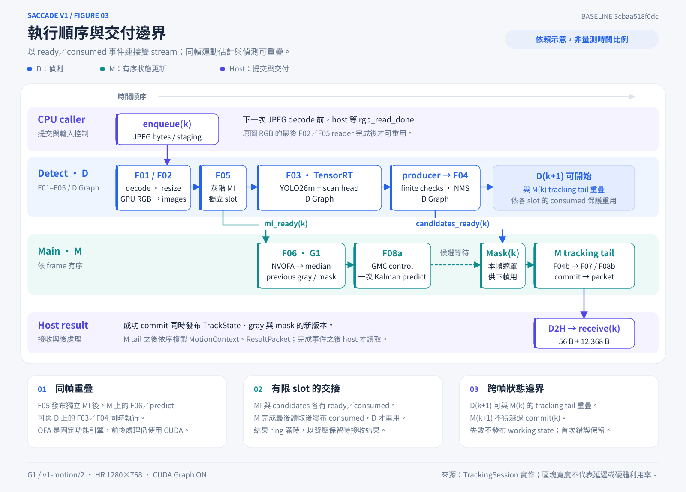

[開啟同步與交付時序 SVG](assets/report1-3cbaa518f0dc/schedule.svg)。

2026-11-12 圖解版另補入 [n／n+1 示意與實測時間軸](assets/report1-3cbaa518f0dc/story-schedule.svg)，以原始 G1 node／graph SQLite 重算並核對 Graph 角色與實體 D／M stream。來源、逐幀起訖、busy union 與重疊統計見 [schedule-trace](../../evidence/report1/2026-11-12-schedule-trace/summary.json)；原概念圖與必要依賴保持原樣，新的 profiler 讀值不當作無 profiler 的端到端延遲。

<details>
<summary>查看 Mermaid 依賴對照</summary>

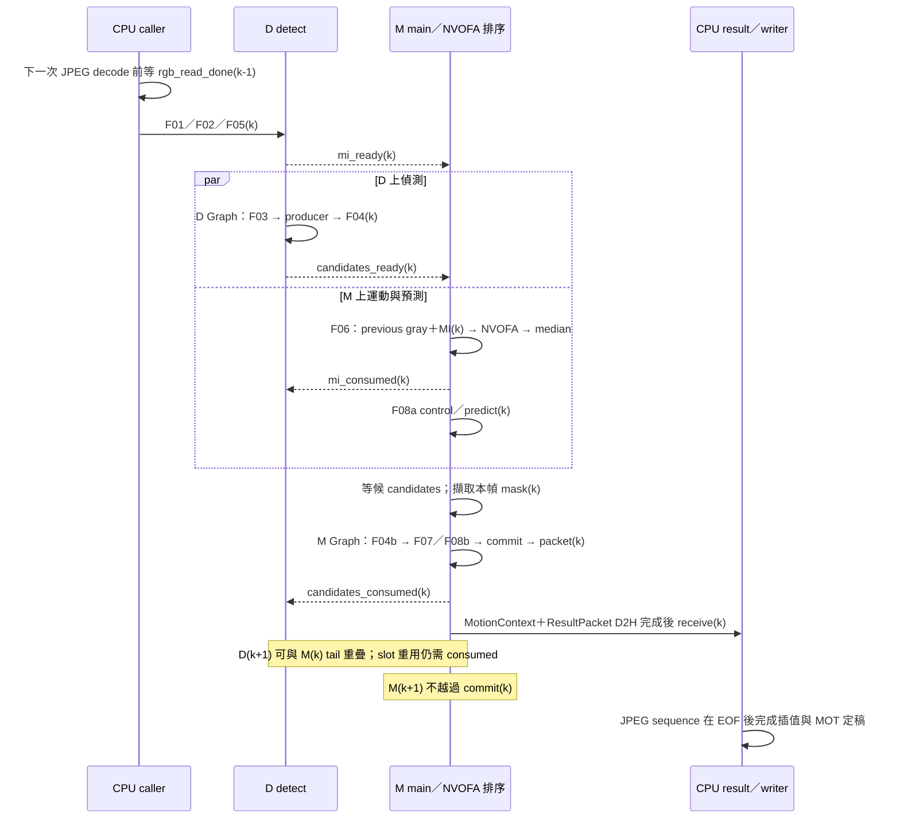

</details>

圖示表達必要順序，沒有以框寬表示實測時間。`ordinary／Graph` 控制是否 replay Graph；`Serial／Pipelined` 控制 session 排程；`single／queued` 控制 benchmark caller 提交／接收方式。三個維度不能互相代稱。

### 4.2 Buffer 生命週期

| 資源 | ready／使用者 | 可覆寫條件 |
| --- | --- | --- |
| 共用原圖 RGB | F01 交付；D 上 F02、F05 讀取 | host 在下一次 nvJPEG decode 前等待 `rgb_read_done`；保護 nvJPEG 私有 stream 與共享 RGB |
| MI ring | D record `mi_ready`，M F06 讀取 | D 重用 slot 前等 `mi_consumed` |
| Candidate ring | D Graph 完成後 ready；M mask／F04b／tail 使用 | M tail 完成後 record consumed；D 重播前 wait |
| TrackState／gray／mask 雙狀態 | M 只寫 working 版本 | 成功 commit 才一起發布；下一幀由 committed slot 取得一致版本 |
| 固定模型 input／raw／scratch | D 上 F02→F03→producer→F04 | 同 stream 次序與固定地址檢查；不借用至未保護的下一次推論 |
| Device packet／pinned host result ring | packet 編碼後 D2H，完成後 host 讀取 | receive 消費前保留 slot；ring 滿時背壓 |

基準 G1 每幀另有 **56-byte MotionContext D2H**，再加 **12,368-byte ResultPacket D2H**，合計 **12,424 B/frame**；不先下載 count 再按 count 下載 rows。早期 DATAFLOW 的「每幀唯一一次 D2H」是原設計描述，不能用來覆蓋此版本實作。1080p RGB payload 為 6,220,800 B，但不因 tracker 運算而逐幀下載到 CPU。[tracking_session.cpp](../../src/tracking_session.cpp)保留兩次 copy 與結果 ring 的實際次序。

成功的空 packet 與 FAILED／SKIPPED packet 分開；容量超出回報 OVERFLOW，不靜默截斷。TrackState 容量 512、DetectionBatch 300、ResultPacket 256 rows；packet header 80 B、每 row 48 B、未用 rows 與 reserved bytes 為 0。完整 byte equality 包含 unused bytes。參見 [RESULT_PACKET](../RESULT_PACKET.md)。

### 4.3 可選影片／即時入口

`track_stream` 的預設資料流是 **FFmpeg 收流／demux → NVDEC → device NV12／P010 → D 上 CUDA 色彩轉換／F02 → 相同 TrackingSession → 即時觀測輸出**。`--decode cpu` 才走 CPU decode、host RGB staging 與 H2D，GPU 失敗不自動切 CPU。

此 CLI 每幀 enqueue 後立即 receive／flush，result ring=1；不宣稱多幀 queued 的吞吐 overlap。它使用 `stream-observations/1`，不做序列尾插值與全序列 ID 重編號，因此與 JPEG sequence 的 `v1-mot/1` 是不同輸出政策。來源 PTS 沒有改變固定步長 Kalman dt。現有功能與搬移 trace 證據不構成攝影機／RTSP 的完整端到端延遲量測，參見 [STREAMING](../STREAMING.md)。

## 5. End-to-end 的計時契約

### 5.1 五個不同時鐘邊界

| 指標 | 起點 → 終點 | 包含 | 排除／限制 |
| --- | --- | --- | --- |
| 暖機後 single latency | `enqueue(k)` 前 → 同幀 blocking `receive()` 返回 | host 提交、前處理、模型、GMC、tracking、packet D2H／解析 | JPEG 預載；不含磁碟、constructor、暖機、MOT 寫檔；起點無前幀在途 |
| queued delivery latency | `enqueue(k)` 前 → caller 實際 `receive(k)` | 同上，加在途排隊、資源等待與 caller 延後取結果 | 同一結果可能已 GPU 完成，但 caller 尚未取出 |
| queued wall interval | 測量區間 wall time ÷ 完成幀數 | pipeline overlap 下整段完成速率 | 不是任一幀從輸入到交付的延遲 |
| `track_sequence` ms/frame | 第一張 JPEG 讀取前 → `finish()`／所有結果 drain 完成，再除以幀數 | JPEG 讀檔、host input、lazy capture、所有幀處理、`output.add`、finish/drain | 不含 session constructor、checked close、`output.finish()` 插值與最終 MOT／packet／motion 檔案寫入 |
| 外部即時端到端延遲 | 相機曝光／可信來源時間戳 → 下游實際收到結果 | 網路、demux、decode reorder、背壓、GPU、輸出／消費 | 本輪沒有涵蓋此完整邊界的量測 |

`FPS = 1000 / interval_ms` 只把處理間隔換成吞吐。比如 5.443 ms/frame 可對應約 183.7 FPS，不能據此聲稱每幀在 5.443 ms 內交付；同時在途多幀時，交付延遲可以明顯更長。

### 5.2 階段計時也有不同口徑

GPU **busy** 是某階段、某幀活動區間的聯集；**envelope** 是第一個活動開始到最後一個活動結束，包含空檔與等待。CUDA event、host wall clock 與 Nsight 插樁得到的數字不是同一量。

端到端關鍵路徑可概念化為「輸入交付 → F02/F05 → 等待本幀偵測與 motion/predict 兩條必要路徑都完成 → mask／tracking tail → D2H／caller receive」。實際還受 slot 背壓、host submission、私有函式庫工作與跨幀資源競爭影響。**不能把各階段平均值、p95 或互相重疊的 envelopes 相加，宣稱得到實測端到端延遲。**

## 6. 基準所採 G1 路徑的完整序列紀錄

### 6.1 七序列：serial 與 pipelined 吞吐

以下為乾淨 `fae5cb7` 的 G1 正式驗收，motion=`v1-motion/2`、HR engine 固定。Serial 每序列一筆整段時間；pipelined 每序列三次，表內 G1 是累計 wall time／累計幀數。原始表：[serial-latency.csv](../../evidence/tracking-session/2026-11-05-v1-motion-2-acceptance-2/capture/serial-latency.csv)、[throughput.csv](../../evidence/tracking-session/2026-11-05-v1-motion-2-acceptance-2/capture/throughput.csv)。

| 序列 | 每序列幀數 | G1 serial ms/frame | G1 pipelined ms/frame | Pipelined FPS | 舊 PCR pipelined ms/frame | G1 時間變化 |
| --- | ---: | ---: | ---: | ---: | ---: | ---: |
| MOT17-02-SDP | 600 | 6.916350 | 5.263333 | 190.0 | 5.112489 | +2.95% |
| MOT17-04-SDP | 1,050 | 7.158781 | 5.572737 | 179.4 | 5.386384 | +3.46% |
| MOT17-05-SDP | 837 | 6.176643 | 5.314190 | 188.2 | 5.296918 | +0.33% |
| MOT17-09-SDP | 525 | 6.694933 | 5.341175 | 187.2 | 5.267759 | +1.39% |
| MOT17-10-SDP | 654 | 6.862462 | 5.566458 | 179.6 | 5.263629 | +5.75% |
| MOT17-11-SDP | 900 | 6.872489 | 5.488419 | 182.2 | 5.319600 | +3.17% |
| MOT17-13-SDP | 750 | 6.957507 | 5.460227 | 183.1 | 5.365316 | +1.77% |
| **依幀數加權／總計** | **5,316** | **6.817652** | **5.443318** | **183.711** | **5.300288** | **+2.70%** |

Serial 總計為 `36,242.64 ms / 5,316 frames`；pipelined 每臂實際共 15,948 幀。原報告將 serial 欄稱「單幀延遲」，但 CSV 只有每序列 wall time 與平均值，**沒有逐幀樣本、暖機剔除或 p50／p95／p99**；本稿依工具計時邊界稱作 serial 全序列平均處理時間。

新舊 motion 的總時間增加 2.69853%，通過事前設定的總計 3% 上限；不是每個序列都低於 3%。三輪分開為 +2.66%、+2.26%、+3.17%；MOT17-10 第三輪 G1 為 5.92 ms/frame，原資料保留該長尾。每組都是 PCR 先、G1 後，未反轉順序；遙測持續執行。因此這是該輪驗收的吞吐觀測，不推導時脈／溫度無關的普遍差值。[原報告 §8](../../evidence/tracking-session/2026-11-05-v1-motion-2-acceptance-2/REPORT.md)保留完整限制。

### 6.2 較新的預設 OFF 效能紀錄

乾淨 `527ffe5` 的 NSA v2 驗收中，HR pipelined 七序列各跑三次，每臂共 21 runs／15,948 幀。由 [SUMMARY.json](../../evidence/nsa-v2/2026-11-09-formal-527ffe5/SUMMARY.json) 的 `step5_record_only.native_ms_per_frame` 重算，預設 OFF 所有 runs 按幀數加權平均為 **5.208166 ms/frame（192.006 FPS）**。這與上表 G1 使用不同來源與量測時段，不作跨報告的加速幅度計算。

原正式報告 §4 的各序列列值是三次中位數，但總列 5.208→5.236 符合所有 21 runs 的加權平均；若將各序列中位數加權，OFF／ON 實際為 5.204614／5.235223。這是本次 raw JSON 核對釐清的聚合口徑，原證書維持原樣。

開啟 NSA／量測框後，所有 runs 加權為 **5.235763 ms/frame**，重算時間增加 **0.529878%**；harness 先跑完全部預設臂再跑全部開啟臂，非 ABBA，原報告明列不足以把微小差值與順序／溫度漂移分開。MOT17-04 records 的 tracker 單段 GPU 平均為 OFF 403.27 µs、ON 406.07 µs；它不是整條 tracking session 的時間。[NSA 正式報告 §4](../../evidence/nsa-v2/2026-11-09-formal-527ffe5/REPORT.md)。

### 6.3 G1 與 F03 的重疊證據

G1 驗收的 Nsight capture 含 30 幀，首幀不執行 OFA，後續 29 幀中 **28 幀**的 OFA 可觀測外包界限完全落在同幀 F03 內；第一個 Execute 的界限較長。界限定義為輸入複製完成到 cells 開始之間，中位數約 **2.22 ms**。工具沒有直接看到 OFA 固定功能引擎本體，所以這是**間接時間界限**，不能標成 OFA engine 精確延遲。[ofa-overlap.csv](../../evidence/tracking-session/2026-11-05-v1-motion-2-acceptance-2/capture/ofa-overlap.csv)。

另外原驗收報告記錄 A5 host `NvOFExecute` 提交中位數 **0.709 ms**、p95 **0.931 ms**，量的是 host API 呼叫；也不能與上述界限相加，當成完整 F06 時間。原 p95 採不同取樣索引；本稿若對 raw 240 筆統一使用 nearest-rank，則為 **0.927673 ms**、median **0.7091995 ms**，原報告數字保留。[G1 正式報告](../../evidence/tracking-session/2026-11-05-v1-motion-2-acceptance-2/REPORT.md)、[ofa-trials.csv](../../evidence/tracking-session/2026-11-05-v1-motion-2-acceptance-2/capture/ofa-trials.csv)。

這些證據支持既有 D／M 排程可以隱藏大部分 OFA 工作；本稿沒有把尚未封存為逐階段統計的完整 G1 F06、mask 或 current queued 交付分布補成數值。

## 7. 暖機後延遲與加速：較早的 cuFFT 控制實驗

### 7.1 Clean-source ABBA 的完整結果

本節 motion 固定為 **`v1-motion/1`**，不代表基準 G1 的逐幀延遲。比較乾淨 `f4865cd` 與乾淨 `23ade53`，engine 不重建；tracking 同時涵蓋 F02 tile fusion、F03 N16／部署特化的合併改動。

| 指標 | 加速前 | 加速後 | 時間降低 |
| --- | ---: | ---: | ---: |
| F02 isolated ordinary interval | 148.490000 µs | 87.931700 µs | 40.78% |
| F02 isolated Graph interval | 147.138000 µs | 88.483100 µs | 39.86% |
| 完整 F03 ordinary | 6.557451 ms | 6.195495 ms | 5.52% |
| 完整 F03 Graph | 5.241696 ms | 4.904589 ms | 6.43% |
| Tracking single mean | 7.092724 ms | 6.626377 ms | 6.58% |
| Tracking single p50 | 7.045901 ms | 6.568929 ms | 6.77% |
| Tracking single p95 | 7.524795 ms | 7.059455 ms | 6.18% |
| Tracking single p99 | 7.719933 ms | 7.312254 ms | 5.28% |
| Tracking single min | 6.589859 ms | 6.209250 ms | 僅記錄 |
| Tracking single max | 8.385982 ms | 8.595218 ms | 僅記錄；candidate 最大值較高 |
| Queued wall interval | 5.536401 ms/frame | 5.123390 ms/frame | 7.46% |
| Queued throughput | 180.623 FPS | 195.183 FPS | 吞吐增加 8.06% |

方法與樣本：

- Tracking 使用 MOT17-10 前 140 幀，每個 fresh session 從 frame 0 建立相同歷史，20 幀暖機、120 幀量測；JPEG 預載、Graph ON、result_slots=4。
- 兩輪外層 A→B→B→A，共 32 sessions；每 backend 有 960 個 single samples、8 個 queued intervals。分位數從逐幀樣本計算，不對各次 p95 再平均；全部長尾保留。
- 完整 F03 固定 input 0 計時、四個 inputs 驗證；每 backend／mode 1,600 個 samples；排除 H2D／D2H、初始化、暖機與 profiler。
- F02 為 deterministic xorshift RGB，1920×1080→1280×768；每 entry 暖機 40 次、batch 200 次。F02 Graph 是 primitive 測試；session 的 F02 仍在 D Graph 外。
- 四個完整模型 outputs／statuses 與 32 份 140 幀完整 packets 逐 byte 相同；本次沒有重新計分或重跑 sanitizer。

原始證據：[REPORT](../../evidence/f02-f03/2026-11-05-clean-performance/REPORT.md)、[analysis.json](../../evidence/f02-f03/2026-11-05-clean-performance/analysis.json)、[逐幀 latencies](../../evidence/f02-f03/2026-11-05-clean-performance/tracking-latencies.csv)、[runs](../../evidence/f02-f03/2026-11-05-clean-performance/tracking-runs.csv)。Baseline 的 model benchmark driver 由 candidate source 編譯、只連 baseline runtime libraries；tracking binaries 則各由完整 clean commit 建置，此 provenance 差異保留。

### 7.2 初始化與首幀另列

由上述 `tracking-runs.csv` 重新彙整，每 backend 各 16 sessions，混合 single／queued 兩種 caller 風格：

| 指標 | 加速前 min／median／max | 加速後 min／median／max |
| --- | --- | --- |
| Session constructor（ms） | 379.322／406.655／1,458.248 | 374.020／392.436／1,504.050 |
| 首幀 enqueue→receive（ms） | 16.595／17.196／24.586 | 15.459／16.601／21.712 |

Constructor 與首幀受載入、cache、lazy capture 等影響；這是歷史 runs 的描述統計，不能將 constructor 差異判成穩定加速，也不能把暖機後平均 6.626 ms 套到冷啟動。此處中位數用排序後中間兩值平均，沒有剔除任何 session。

### 7.3 Queued 交付與 ring 深度

以下是更早 `865bb10`＋dirty source、cuFFT profile 的資源量測，不與上節 clean ABBA 合併。主 ABBA 的 Graph single 平均／p95 為 **6.988／7.405 ms**，queued wall interval **5.412 ms/frame**；另一個 probe 實測四格 ring 的 enqueue→caller receive 平均／p95 是 **21.217／21.768 ms**，同次 probe 的 interval 是 5.379 ms/frame。

額外每個 depth 各一個 fresh session、120 幀的觀測如下：

| Result ring depth | Delivery mean（ms） | Delivery p95（ms） | Wall interval（ms/frame） |
| ---: | ---: | ---: | ---: |
| 1 | 6.993 | 7.379 | 7.002 |
| 2 | 10.740 | 11.259 | 5.396 |
| 4 | 21.289 | 22.452 | 5.401 |

Depth 4 的 21.289 與前段 21.217 來自不同次 probe，兩者都保留。當時 depth 2 觀察到接近 depth 4 的吞吐與較短交付時間，但沒有 ABBA、沒有 G1／其他負載重驗，專案仍維持四格 API 預設。ring 深度與 caller 接收政策同時影響交付延遲，不能僅用吞吐決定即時性。[resource-schedule §2](../../evidence/resource-schedule/2026-11-04/REPORT.md)、[queue-depth-summary.json](../../evidence/resource-schedule/2026-11-04/raw/queue-depth-summary.json)。

## 8. 分階段時間與瓶頸歸因

### 8.1 歷史 Nsight 階段表：僅適用 cuFFT profile

本表完整保留 `resource-schedule` 的原始口徑：dirty 開發來源、`v1-motion/1`、Graph，single／queued 各排除 20 幀暖機後量 120 幀，單位 **µs**。**F05 的 Hanning、F06 的 cuFFT 與僅 packet 12,368 B D2H 都是當時的路徑，不能套用成現行 G1 數字。**

| 階段 | Single busy | Single envelope | Queued busy | Queued envelope | 硬體／位置 |
| --- | ---: | ---: | ---: | ---: | --- |
| F01 壓縮 JPEG H2D | 10.61 | 10.61 | 12.82 | 12.82 | Copy engine |
| F01 RGB 轉換 | 32.73 | 32.73 | 29.46 | 29.46 | SM、nvJPEG 私有 stream |
| F02 HR resize／正規化 | 142.96 | 145.71 | 149.52 | 153.11 | SM、D |
| F05 灰階縮小／Hanning | 6.61 | 8.70 | 6.50 | 8.64 | SM、D |
| F03 完整 TensorRT | 4,873.82 | 4,989.81 | 5,003.80 | 5,132.68 | Tensor Cores＋SM、D Graph |
| Producer finite／status | 27.50 | 27.89 | 28.18 | 28.57 | SM、D Graph |
| F04 decode／NMS | 95.76 | 96.47 | 99.65 | 100.39 | SM、D Graph |
| F06 GMC 含 cuFFT | 120.50 | 448.77 | 99.88 | 226.44 | SM／cuFFT、M |
| F08a control／predict | 67.70 | 114.02 | 61.52 | 107.42 | SM、M |
| F04b continuation batch | 111.78 | 111.78 | 682.08 | 682.08 | SM、M Graph |
| F07／F08b 關聯更新 | 96.29 | 96.46 | 219.32 | 251.67 | SM、M Graph |
| Commit | 0.72 | 0.72 | 0.88 | 0.88 | SM、M Graph |
| Packet 編碼 | 2.41 | 2.41 | 2.92 | 2.92 | SM、M Graph |
| Packet D2H | 2.00 | 2.00 | 2.12 | 2.12 | Copy engine、M |

原表另記錄分散的 begin／stage controls／candidate checks，未集中到上述單一階段；其跨幀等待 envelope 不宜當成控制 kernel 成本。[stage_summary.csv](../../evidence/resource-schedule/2026-11-04/stages/stage_summary.csv)含 mean、p50、p95、p99、min、max；[stage_samples.csv](../../evidence/resource-schedule/2026-11-04/stages/stage_samples.csv)保留逐幀資料。

### 8.2 F01／F02 隔離量測

同一歷史資源報告另在 GPU idle、JPEG 預載、不載入模型下，量 120 幀：

| 範圍 | 平均（µs） | p95（µs） |
| --- | ---: | ---: |
| F01 host 起點→RGB ready | 1,454.37 | 1,715.97 |
| 其中 staging memcpy＋檢查／parse | 15.46 | 18.27 |
| Decode API host call | 540.80 | 698.76 |
| Decode API 起點→RGB ready | 1,438.90 | 1,702.52 |
| F02 CUDA-event envelope | 155.69 | 188.45 |
| F02 host enqueue→完成 | 190.34 | 224.73 |

Decode host call 是 decode→RGB ready 的子區間，不能再相加。nvJPEG 的 JPEG 硬體 decoder busy time 沒有被 CUDA trace 直接觀察；RGB conversion 使用 SM。此組 F02 是當時未加速路徑的獨立測試，也不能代替 §7 clean candidate 的 88.483 µs 或目前 G1 pipeline 的 F02。來源：[resource-schedule §3](../../evidence/resource-schedule/2026-11-04/REPORT.md)。

### 8.3 可支持的瓶頸判讀

1. **F03 是主要 GPU 計算成本。** 歷史完整 F03 分析將 20 次 Graph、6,040 個 kernel calls 對映到模型：backbone／neck 占 kernel duration 加總 66.12%，head 33.88%；conv／GEMM 63.73%，scan core 15.63%。這是歷史完整模型內部歸因，不是整條端到端延遲比例。[F03 分析](../../evidence/f03-backbone-head/2026-11-04/REPORT.md)。
2. **單 kernel 改善不等於同幅系統改善。** Clean F02 Graph interval 降低 39.86%，F02＋F03 合併改動的 tracking single 只降低 6.58%；原 F04b 整段組裝 kernel 143.57→102.81 µs 時，完整 tracking 只從 7.037→6.978 ms，吞吐幾乎不變。[排序報告](../../evidence/tracking-sort/2026-11-04/REPORT.md)。
3. **重疊仍會競爭資源。** 歷史 queued trace 中 D／M 活動交集平均 1.046 ms/frame，占 M kernel busy 97.14%；但 F04b single／queued busy 111.78／682.08 µs，顯示並行時階段時間可變長。交集不是 SM utilization，也不能直接當成省下的 wall time。[排程報告 §5](../../evidence/resource-schedule/2026-11-04/REPORT.md)。
4. **OFA 是 GPU 內的固定功能引擎。** NVOFA 與 CUDA cores 分開，但前後處理、host Execute、排程與資料搬移仍有成本；「有獨立硬體」不足以推出零延遲或新增 stream 必然更快。現行 G1 的重疊證據見 §6.3。

## 9. 品質、正確性與未完成界線

### 9.1 與效能證據一起引用的驗證

| 證據 | 已驗範圍 | 不擴大的結論 |
| --- | --- | --- |
| M4／P01 | 固定 HR engine 身分鏈、七序列結果、正式評估 | P01 CLOSED 不代表任意 GPU／SDK／模型支援 |
| clean F02／F03 | 七序列 5,316 幀；7 SCDR＋7 native MOT＋7 offline MOT 等於 M4，21/21 | 原 `v1-motion/1` 的正確性，不關閉 current G1 sanitizer gate |
| clean ABBA | 四張 raw outputs／statuses、32 份完整 packets 相同 | 固定輸入／prefix 的輸出等價，不是品質重評 |
| G1 整合 | MOT17 7/7、PP22 69/69 等於研究 G1；serial／pipeline packets 相同；八步通過 | 完整 session memcheck 仍 OPEN，判定 `NOT A FULL PASS` |
| NSA v2 | CPU 21/21、CUDA 70/70；OFF 回歸不變，ON 的 80 序列 CPU／CUDA parity | 四種 sanitizer 只涵蓋 tracker suite＋recorded 60 幀，不是完整 session sanitizer |
| 基準收尾 | 既有 CPU build 21/21、評分工具合成測試 12/12、共享權重／路徑核對 | 未跑新的 clean-source GPU acceptance、品質或效能測試 |

如需第一輪品質背景，M4 的 MOT17-02 首次 held-out 結果為 HOTA 40.625、IDF1 49.290、AP50 72.91%；G1 接續後該序列為 HOTA 約 40.57、IDF1 約 49.15，屬 **M4 之後**結果，不再稱新的獨立 eval。G1 MOT17-10 val 為 HOTA 約 50.87、IDF1 約 64.97、IDSW 56。這些數字依 [M4](../../evidence/m4/2026-11-03-formal-cad5298/REPORT.md) 與 [G1](../../evidence/tracking-session/2026-11-05-v1-motion-2-acceptance-2/REPORT.md) 引用；本稿沒有重新讀 GT 或計分。

<!-- BEGIN GENERATED MODEL COMPARISON -->
### 9.2 官方原版對照與各資料集表現

本節補入 2026-11-11 已完成的本機 TensorRT 三方研究，固定 runtime 基準仍為 `3cbaa518f0dc`；這些新增引用的比較證據未包含在原報告基準 commit 中。本次只讀取既有分數與效能摘要，沒有重跑推論、計分、訓練或調參。模型分為官方預訓練 YOLO26m、UA2 teacher e4 primary EMA 微調 YOLO26m，以及目前 Full25 mixed student e10 primary EMA HR Mamba。

三方採相同 native F01／F02、1280×768、batch 1、FP16 allowed、FP32 I/O、共用 F04 與 G1 tracker；Graph ON，candidate／motion／result slots=2／2／4，NSA 與量測框 OFF。各模型使用自己的偵測及 detector-conditioned GMC，並非固定同一份 motion 的單因素消融。

**官方對照的範圍：**此處官方與微調 YOLO26m 都使用 raw6 **one2many** head，接本專案共用 F04／G1 tracker；不是 Ultralytics 預設 **one2one/end2end** 完整流程，也不是官方追蹤器的排名。既有研究另有官方原始 one2one 的模型層控制，但未對其完整追蹤品質重新評分，因此不混入本節品質表。

所有品質指標為 0–100 尺度，差值為百分點（pp）；IDSW 是次數，越低越好。DetA／AssA 為 HOTA 的偵測／關聯指標，不是 AP50。彙總使用 frozen TrackEval 的完整 raw metric objects 與 `combine_sequences`，沒有平均各段 HOTA。表格顯示三位小數，完整精度及 FP／FN／Frag 見原始 JSON／逐段 CSV。

#### 五資料集覆蓋與 HOTA 對照

每模型完整覆蓋 **156 段／135,503 幀**，三模型合計 468 cells／406,509 幀；21 個 MOT17 cells 逐檔核對後沿用前輪 native TRT 結果，其餘 447 cells 為該輪新增推論。PP22 即 PersonPath22，48,452 是完整序列幀數，其中 **8,753 個有 GT 的原始影格**參與計分；其餘幀仍推論，計分前只保留 GT 存在幀的預測，保留原幀號。這些是本機指定 split／資料池，並非各資料集官方隱藏測試集排名。

資料來源為 MOT17 `train` 七個不同 SDP 序列、MOT20 `train` 四段、MOT15 `train` 十一段、DanceTrack `train` 40＋`val` 25 段，以及 PP22 `mot_test_kf` 69 段。這裡的 train 是原始資料集目錄名，實際本地模型訓練角色另見下述訓練來源界線。

| 資料集 | 段數 | 幀數／模型 | 官方 HOTA | 微調 HOTA | HR HOTA | Δ HR−官方 | Δ HR−微調 |
| --- | --- | --- | --- | --- | --- | --- | --- |
| MOT17 | 7 | 5,316 | 46.011 | 61.030 | 63.083 | +17.072 | +2.053 |
| MOT20 | 4 | 8,931 | 16.892 | 29.647 | 37.390 | +20.498 | +7.742 |
| MOT15 | 11 | 5,500 | 43.277 | 44.901 | 45.054 | +1.777 | +0.153 |
| DanceTrack | 65 | 67,304 | 35.869 | 36.245 | 35.702 | -0.167 | -0.543 |
| PP22 | 69 | 48,452 | 43.638 | 43.623 | 41.649 | -1.989 | -1.974 |

#### 七個主要群組：保留場景差異

| 主要群組 | 段數 | 官方 HOTA | 微調 HOTA | HR HOTA | Δ HR−微調 | 逐段 HR／微調 勝／平／負 |
| --- | --- | --- | --- | --- | --- | --- |
| MOT17/all | 7 | 46.011 | 61.030 | 63.083 | +2.053 | 4/0/3 |
| MOT20/all | 4 | 16.892 | 29.647 | 37.390 | +7.742 | 4/0/0 |
| MOT15/moving | 5 | 40.244 | 44.184 | 43.335 | -0.849 | 1/0/4 |
| MOT15/other | 6 | 47.116 | 45.783 | 47.275 | +1.492 | 1/0/5 |
| DanceTrack/all | 65 | 35.869 | 36.245 | 35.702 | -0.543 | 29/0/36 |
| PP22/moving | 9 | 45.152 | 44.694 | 42.607 | -2.087 | 2/0/7 |
| PP22/static | 60 | 43.527 | 43.546 | 41.581 | -1.965 | 14/0/46 |

HR 相對微調 YOLO26m 的七個主要群組為 **3 勝／0 平／4 負**，156 段為 **55 勝／0 平／101 負**。MOT17／MOT20 合併 HOTA 分別增加 2.053／7.742 pp；DanceTrack 與 PP22 則分別下降 0.543／1.974 pp。MOT15 合併僅增加 0.153 pp，moving 子群仍下降 0.849 pp，且全 11 段只有 2 段增加。即使相對官方預訓練版，HR 在 DanceTrack 與 PP22 的 HOTA 也較低。因此現有結果支持資料集相關的取捨，不能宣稱普遍優於官方或微調原版。

MOT17 雖然 HOTA／IDF1 合併增加，IDSW 仍由微調版 364 增至 HR 385；MOT20 由 2,401 增至 3,754，PP22 由 4,484 增至 5,138。需同時檢視偵測、關聯與身份切換，不能從單一總分推論身份穩定全面改善。

#### 偵測、關聯與身份完整指標

| 資料集 | 模型 | HOTA | DetA | AssA | IDF1 | MOTA | IDSW |
| --- | --- | --- | --- | --- | --- | --- | --- |
| MOT17 | 官方 YOLO26m | 46.011 | 42.638 | 50.107 | 55.597 | 45.275 | 332 |
| MOT17 | 微調 YOLO26m | 61.030 | 63.036 | 59.670 | 71.329 | 73.291 | 364 |
| MOT17 | 現行 HR Mamba | 63.083 | 66.295 | 60.523 | 71.528 | 76.216 | 385 |
| MOT20 | 官方 YOLO26m | 16.892 | 8.196 | 34.995 | 15.976 | 9.598 | 418 |
| MOT20 | 微調 YOLO26m | 29.647 | 27.800 | 32.076 | 41.116 | 36.965 | 2401 |
| MOT20 | 現行 HR Mamba | 37.390 | 41.121 | 34.505 | 51.204 | 54.961 | 3754 |
| MOT15 | 官方 YOLO26m | 43.277 | 40.579 | 46.502 | 55.483 | 22.676 | 261 |
| MOT15 | 微調 YOLO26m | 44.901 | 41.253 | 49.103 | 56.522 | 19.777 | 211 |
| MOT15 | 現行 HR Mamba | 45.054 | 41.218 | 49.557 | 56.816 | 19.178 | 211 |
| DanceTrack | 官方 YOLO26m | 35.869 | 60.478 | 21.515 | 36.675 | 74.088 | 7734 |
| DanceTrack | 微調 YOLO26m | 36.245 | 61.008 | 21.775 | 37.520 | 76.594 | 7646 |
| DanceTrack | 現行 HR Mamba | 35.702 | 59.367 | 21.702 | 37.431 | 73.996 | 8318 |
| PP22 | 官方 YOLO26m | 43.638 | 45.211 | 42.521 | 48.216 | 47.942 | 4517 |
| PP22 | 微調 YOLO26m | 43.623 | 45.663 | 42.240 | 50.269 | 43.333 | 4484 |
| PP22 | 現行 HR Mamba | 41.649 | 44.103 | 39.914 | 47.947 | 39.138 | 5138 |

#### 同條件 TensorRT 的速度與成本

此表引用另一輪受控效能研究：RTX 5070 Ti Laptop、相同 TensorRT SDK／輸入與交錯順序；tracking 使用 MOT17-10 前 140 幀，20 幀暖機、每模式四個 fresh sessions／480 個量測樣本，JPEG 預載。Single 為 enqueue→receive；queued FPS 為整段完成吞吐。均排除讀檔、初始化、暖機與寫檔，不代表完整資料集或攝影機端到端效能。F03 為模型層 GPU events，與完整 tracking 的量測終點不同。

| 模型 | F03 Graph GPU mean ms | Tracking single mean ms | single p95 ms | queued FPS | Engine MiB |
| --- | --- | --- | --- | --- | --- |
| 官方 YOLO26m | 3.744 | 5.734 | 6.938 | 245.175 | 42.506 |
| 微調 YOLO26m | 3.809 | 5.938 | 7.178 | 230.123 | 40.868 |
| 現行 HR Mamba | 4.790 | 6.816 | 7.139 | 194.417 | 57.939 |

HR 相對微調版在 MOT17-10 的 single 平均延遲增加 14.79%、queued 吞吐下降 15.52%；另測 MOT17-02 為 +17.42%／−15.13%。F03 Graph mean 增加 25.76%，engine 檔案增加 41.77%；execution-context scratch bound 同為約 135.17 MB，不代表完整行程顯存相同。MOT17-10 的 HR single p95 略低，02 則較高，尾延遲亦非全場景一致。

逐幀交付延遲的 P95／P99（ms）：各組四次 session 的 480 筆暖機後樣本合併後取 nearest-rank，single 與 queued 分開。

| 序列 | 模型 | Single P95 | P99 | Queued P95 | P99 |
| --- | --- | --- | --- | --- | --- |
| MOT17-10 | 官方 YOLO | 6.938 | 7.088 | 16.954 | 17.317 |
| MOT17-10 | 微調 YOLO | 7.178 | 7.339 | 19.908 | 20.529 |
| MOT17-10 | HR Mamba | 7.139 | 7.494 | 21.309 | 21.748 |
| MOT17-02 | 官方 YOLO | 5.882 | 6.126 | 16.761 | 16.994 |
| MOT17-02 | 微調 YOLO | 6.024 | 6.160 | 19.984 | 20.255 |
| MOT17-02 | HR Mamba | 6.999 | 7.214 | 21.216 | 21.539 |


另列官方原始 one2one/end2end 的模型層 Graph 控制（四張固定輸入、每模型四個 fresh processes／1,280 樣本）：

| 模型 | GPU mean ms | GPU p95 ms |
| --- | --- | --- |
| 官方原始 one2one | 3.862 | 3.916 |
| 現行 HR Mamba | 4.871 | 4.955 |

官方輸出為 `[1,300,6]`，engine 內含 decode／TopK；HR 仍輸出 raw6，兩者輸出終點不同。這一列控制不提供完整 tracking 品質或吞吐，也不與前表不同 campaign 的均值相減推導階段成本。

#### 解讀與證據界線

- 全部 156 段皆已曝露；MOT17 的 04／05／09／11／13 為兩條本地模型 lineage 的訓練序列、10 用於選模，02 是 M4 之後重用的原 held-out。官方預訓練 corpus 未全面稽核，不能套用本地訓練分工。DanceTrack 為 train＋val 的既定資料池，其餘來源／split 見 frozen selection。
- 微調版與 HR 的訓練配方、來源及 score calibration 不同；差值不能單獨歸因於 Mamba。七組與逐段結果優先，跨資料集 pooled 值不作主要排名或採用門檻。
- 官方／微調 FP16 engine 的既有 1% raw relative-L2 screen 仍為 **FAIL**，最大 2.406%／1.537%；任務分數、finite／repeat／Graph 通過不取代數值驗收，也不升格成正式 session／sanitizer／部署驗收。
- SportsMOT 依既定政策排除主要推論、評分、gate 與參數選擇；本節的五資料集與七群組均不含它。
- primary156 不測速，capture wall time 含 lock wait，不用來推算各資料集 FPS。各資料集沒有完整同口徑 AP50 與效能矩陣者不補造數字；現有可比項目以本節為準。部署模型與預設維持不變。

來源：[primary156 報告](../../evidence/model-comparison/2026-11-11-yolo26m-primary156/bundle/REPORT.md)、[完整分數](../../evidence/model-comparison/2026-11-11-yolo26m-primary156/bundle/metrics/summary.json)、[逐段 CSV](../../evidence/model-comparison/2026-11-11-yolo26m-primary156/bundle/metrics/per-sequence.csv)、[獨立 scoring audit](../../evidence/model-comparison/2026-11-11-yolo26m-primary156/bundle/audits/scoring-audit.json)、[訓練來源](../../evidence/model-comparison/2026-11-11-yolo26m-primary156/bundle/training-provenance.json)、[固定 selection](../../evidence/model-comparison/2026-11-11-yolo26m-primary156/bundle/methods/scoring-tools/selection-frozen.json)；[TRT 效能比較](../../evidence/model-comparison/2026-11-11-yolo26m-trt-performance/REPORT.md)、[pipeline 原始摘要](../../evidence/model-comparison/2026-11-11-yolo26m-trt-performance/performance/pipeline/summary.json)、[驗證界線](../../evidence/model-comparison/2026-11-11-yolo26m-trt-performance/validation.json)。本節表格由 [render_comparison.py](latex/report1/render_comparison.py) 讀取以上既有 JSON 產生，來源 hashes 見 [comparison-sources.json](latex/report1/comparison-sources.json)。

<!-- END GENERATED MODEL COMPARISON -->

### 9.3 保留的 OPEN

- 完整 G1／HR session memcheck：NVOF 內部診斷仍 OPEN；輸出相同不等於 sanitizer PASS。
- 原生排隊／未過濾 Graph 完整 HR racecheck：仍 OPEN。普通 serial 的 `PASS_FORCED_SYNC` 與自訂＋CUB 的 `PASS_FILTERED_FORCED_SYNC` 是修改驗證排程的有限結果，不取代原 gate。
- nvJPEG initcheck FAIL／原因 OPEN；完整 initcheck 補驗出現診斷後 timeout，未完成。受測完整 synccheck 的 PASS 與此分開。
- P08 GPU 完整中間事件與觀察開關一致性未結案；CPU 事件／packet binding 不覆蓋 GPU 全部中間轉移。
- 外部攝影機／RTSP 的真實連線、重連、跨 GPU／SDK、fatal recovery 與額外 durability 依各自契約另處理。
- `3cbaa518f0dc` 的 G1 逐幀 single／queued latency、冷啟動分布與即時來源到消費者延遲尚未補量。

完整狀態以基準內的 [STATUS](../STATUS.md)、[BACKLOG](../BACKLOG.md)、[HR 補驗](../../evidence/hr-sanitizer/2026-11-05-a00ab3a/REPORT.md)、[有界排隊補驗](../../evidence/hr-sanitizer/2026-11-06-bounded-queue/REPORT.md)為據。

## 10. 引用、重算與後續補量

### 10.1 本稿證據索引

| 主題 | 主要來源 |
| --- | --- |
| 報告基準與收尾 | [第一輪版本收尾](../history/2026-11-11-first-report-baseline.md)、[checks.json](../../evidence/report1/2026-11-11-closeout/checks.json) |
| 官方／微調 YOLO26m 與各資料集品質 | [primary156 REPORT](../../evidence/model-comparison/2026-11-11-yolo26m-primary156/bundle/REPORT.md)、[完整分數](../../evidence/model-comparison/2026-11-11-yolo26m-primary156/bundle/metrics/summary.json)、[訓練來源](../../evidence/model-comparison/2026-11-11-yolo26m-primary156/bundle/training-provenance.json) |
| 同條件三模型效能 | [TRT 比較 REPORT](../../evidence/model-comparison/2026-11-11-yolo26m-trt-performance/REPORT.md)、[來源 hashes](latex/report1/comparison-sources.json) |
| 現行執行順序／D2H／生命週期 | [tracking_session.cpp](../../src/tracking_session.cpp)、[flow_motion.cu](../../cuda/flow_motion.cu)、[TRACKING](../TRACKING.md) |
| Shape／模型 | [model_profile.hpp](../../include/saccade/model_profile.hpp)、[head_trt_network.cpp](../../src/head_trt_network.cpp)、[model_trt_network.cpp](../../src/model_trt_network.cpp) |
| 計時工具邊界 | [track_sequence.cpp](../../tools/track_sequence.cpp)、[tracking_benchmark.cpp](../../tools/tracking_benchmark.cpp) |
| G1 全序列時間 | [G1 REPORT](../../evidence/tracking-session/2026-11-05-v1-motion-2-acceptance-2/REPORT.md)、[throughput-runs.csv](../../evidence/tracking-session/2026-11-05-v1-motion-2-acceptance-2/capture/throughput-runs.csv) |
| G1 重疊界限 | [stream-placement.txt](../../evidence/tracking-session/2026-11-05-v1-motion-2-acceptance-2/capture/stream-placement.txt)、[ofa-overlap.csv](../../evidence/tracking-session/2026-11-05-v1-motion-2-acceptance-2/capture/ofa-overlap.csv) |
| Clean 延遲分布 | [clean ABBA REPORT](../../evidence/f02-f03/2026-11-05-clean-performance/REPORT.md)、[analysis.json](../../evidence/f02-f03/2026-11-05-clean-performance/analysis.json) |
| 歷史分階段／交付延遲 | [資源 REPORT](../../evidence/resource-schedule/2026-11-04/REPORT.md)、[SCHEDULE](../../evidence/resource-schedule/2026-11-04/SCHEDULE.md)、[安全審查](../../evidence/resource-schedule/2026-11-04/safety-review.md) |
| 較新預設與可選設定 | [NSA 正式 REPORT](../../evidence/nsa-v2/2026-11-09-formal-527ffe5/REPORT.md)、[SUMMARY.json](../../evidence/nsa-v2/2026-11-09-formal-527ffe5/SUMMARY.json) |
| 即時影片入口 | [STREAMING](../STREAMING.md)、[streaming 開發驗證](../../evidence/streaming/2026-11-05-development/REPORT.md) |
| SVG 圖稿與重建 | [圖稿說明／產生器](../../evidence/report1/2026-11-11-detailed-report/diagrams/README.md)；手工配置、共用配色、純向量文字 |

本稿整理時的來源 hashes 與衍生統計見 [latency-summary.json](../../evidence/report1/2026-11-11-detailed-report/latency-summary.json)，重算程式為 [summarize.py](../../evidence/report1/2026-11-11-detailed-report/summarize.py)。所有來源先從固定 Git object 讀取再計算；該 JSON 是本次文件整理的收據，不是新的 runtime／GPU 驗收證書。執行程式只向 stdout 輸出 JSON，不重跑 GPU，也不覆寫歷史證據。

日後 checkout 更新時，以上相對連結會顯示當前檔案；需要固定引用時，使用完整 commit 加 path，例如：

```sh
git show 3cbaa518f0dc37d691404e95ed85c0109c81130d:src/tracking_session.cpp
git show 3cbaa518f0dc37d691404e95ed85c0109c81130d:evidence/f02-f03/2026-11-05-clean-performance/analysis.json
```

### 10.2 若要補成基準版本的完整延遲實測

以下為後續補量可採用的規格；**尚未執行**，本次僅整理既有證據：

1. 從固定 `3cbaa518f0dc` 的乾淨 checkout 重新建置；固定 engine hash、HR profile、G1、NSA OFF、Graph ON、資料 manifest、binary／SDK／GPU 身分，使用新 evidence 目錄並持有 GPU lock。
2. 無 profiler 下分別記錄 constructor、首幀 lazy capture、暖機後 single enqueue→receive，以及 queued 每幀 enqueue→receive／wall interval；保存每幀 timestamps 與 mean／p50／p95／p99／max，不剔除長尾。
3. 磁碟預載與實際讀檔分臂；ring 1／2／4 與接收政策固定，標明測量幀數、fresh sessions 與執行順序。各臂完整 packets 與預期結果逐 byte 對照。
4. 另次 profiler capture 對映 F01、F02、F05、F03、producer、F04、完整 G1 F06、flow mask、predict、F04b、update、commit、兩次 D2H；保留 OFA 間接界限與 CUDA 活動時間的區別。不要用插樁結果取代無插樁主結果。
5. 若範圍含影片／相機，另定來源時鐘、PTS／曝光起點、網路／demux／decode reorder、寫入／flush、下游消費終點；同時記錄輸入節奏、drop／backpressure 與部分輸出的處理政策。

目前文件已足以整理第一輪系統實作與既有階段量測；要宣稱「此固定基準在即時環境的完整 end-to-end p95」則須完成上述相應範圍的補量。
