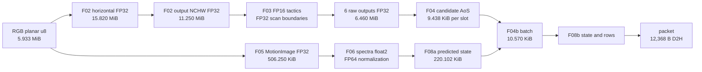

# CUDA kernel 資源與資料格式分析

本分析供後續 kernel 合併、資料排列與 L1／L2 復用規劃使用。範圍是目前 C++／CUDA runtime：1920×1080 JPEG → HR 1280×768 FP16 TensorRT → motion downscale 4 → tracking。**優先研究 F02 的大型 FP32 中間圖、F03 scan 的執行映射，以及 tracking 單 block 內的小資料反覆掃描。** FP16 engine 不代表整條資料流都是 FP16；模型 input、raw outputs、scan plugin 邊界及 tracker 仍是 FP32，GMC 部分運算使用 FP64。

本次增加分析、可重跑 probe 與證據，沒有改動 runtime kernel 或部署設定。資料容量、來源層讀寫量、cache transaction 與實際 DRAM 流量在下文分列。

## 1. 來源與證據範圍

| 證據 | 身分與能支持的結論 |
| --- | --- |
| 現行來源 | `f4865cdb27f0e624b8cc26219e78f4aa938690df`；分析開始時工作樹乾淨 |
| 現行編譯 | CUDA 13.4.92，sm_120，Release 原有算術旗標；獨立編譯 9 個 production CUDA units、47 個函式，保留 [命令](compile-commands.json)、[資源 CSV](compiler-resources.csv)、[ptxas／cubin 原始輸出](compiler-logs/) |
| 本次硬體查詢 | RTX 5070 Ti Laptop GPU，WSL2；[device.json](device.json) 為實際 CUDA API 查詢，並重新確認主要 ABI `sizeof`／offset |
| 既有完整 pipeline 測時 | [resource-schedule 報告](../../resource-schedule/2026-11-04/REPORT.md)，基底 `865bb10` 加當時修改，development capture；下文標為「既有測時」 |
| 舊 capture 與現行 source 對照 | [71 個 CUDA／header／src 檔案逐檔 SHA-256 比對](source-comparison.json) 全部相同；這支持來源對應，不把舊 binary／舊測時改稱本 HEAD 新測時 |
| 本次 cache counters | NCU 2026.3.1；F02 synthetic resize 與一個真實來源的固定 tracking frame，均為隔離 primitive，20 次暖機後取第 21 次；沒有 F03 同時執行 |
| 部署 engine | SHA-256 `8292cc233019d08f1b1b6cfbc12f1fe1644f66f2164fd8f50a69b660a7817876` 重新核對；[engine inspector 摘要](engine-inspector-summary.json) 保留原 build report hash 與精度／shape |

完整 runtime 的既有計算量排序為 F03 約 4.87 ms/frame、F02 約 143 µs、F04 約 96 µs；F04b 在 single／queued 為約 112／682 µs，update 約 96／219 µs。這些是 profiler 下各階段 busy；階段可重疊，不能直接加總成延遲。queued 變慢與資源競爭相符，尚不能單獨歸因於 cache miss。

## 2. 本機資源與 cache 規劃邊界

| 本機 CUDA 查詢 | 數值 |
| --- | ---: |
| SM／compute capability | 46／12.0 |
| L2 | **37,748,736 B = 36 MiB** |
| persisting L2 可設定上限 | 23,592,960 B = 22.5 MiB |
| fresh probe context 的目前 set-aside | 7,077,888 B = 6.75 MiB |
| access policy window 最大範圍 | 134,217,728 B = 128 MiB |
| shared memory／SM，可用量 | 102,400 B = 100 KiB |
| shared memory／block，預設／opt-in | 49,152／101,376 B，即 48／99 KiB |
| driver reserved shared／block | 1,024 B |
| register file／SM | 65,536 個 32-bit registers |
| 最大 resident threads／blocks／SM | 1,536／24 |

**L1 是每個 SM 的快取，L2 才是跨 SM 的共同快取。** 同一 stream 的兩個 kernels 有執行順序，但不保證跑在同一個 SM，也不保證前一 kernel 的 L1 資料留到下一個 kernel。要讓一個 fused block 明確復用資料，應以 registers／shared memory 的 tile 生命週期設計；跨 block／kernel／D-M stream 的復用則評估 L2。shared 可用量不等於可供 global loads 使用的 L1 容量，不能把上表 100 KiB 直接當作 L1 預算。[CUDA memory spaces](https://docs.nvidia.com/cuda/cuda-c-best-practices-guide/index.html#device-memory-spaces)

Access policy window 是一段連續位址的保留偏好，`hitRatio` 不是實測 hit rate，也不是鎖定 cache。多 stream 共用 set-aside；Graph kernel node 有自己的 policy attribute。若採用此機制，須針對實際 captured nodes、分離 allocation 和同時存活範圍設定並驗證；使用結束後撤銷保留偏好。本次未修改 policy；fresh probe 查到的 set-aside 不代表 TensorRT／TrackingSession 已為某個 buffer 設定 policy。[CUDA L2 cache control](https://docs.nvidia.com/cuda/cuda-programming-guide/04-special-topics/l2-cache-control.html)

## 3. 主資料流與配置



完整可排序的 [data-formats.csv](data-formats.csv) 列出 dtype、shape、stride、單份 bytes、份數、owner／生命週期及來源。以下均為原圖 1920×1080、HR 1280×768、MI 480×270；MiB 使用 2²⁰ bytes。

| Buffer | 格式與 byte strides | 每份 B | 份數與用途 |
| --- | --- | ---: | --- |
| RGB | u8 planar `[3,1080,1920]`；row 1,920，plane 2,073,600 | 6,220,800 | 1；D 上 F02／F05 讀 |
| horizontal scratch | FP32 CHW `[3,1080,1280]`；row 5,120，plane 5,529,600 | **16,588,800** | 1；horizontal 寫、vertical 讀 |
| model input | FP32 NCHW `[1,3,768,1280]`；row 5,120，plane 3,932,160 | **11,796,480** | 1；F02 → F03 → producer |
| raw cls／reg | 六個 dense FP32 NCHW tensors；詳 §4 | **6,773,760 合計** | 1 組；F03 → producer → F04 |
| F04 workspace | mixed AoS24／u64 keys／u32 IDs | 698,432 | 1；D 專用，詳 §5 |
| published candidates | header 64 + 300×AoS32；FP32 xyxy／score，u32 class／ID／flags | 9,664 | 2 slots；D → M |
| MotionImage／header | FP32 `[270,480]`，row 1,920；header 為獨立 16 B allocation | 518,400 + 16 | 2 slots；D → M |
| Hanning tables | FP32 `[480]`／`[270]` | 3,000 合計 | 1 組，唯讀 |
| FFT_TMP | complex FP32／float2 `[270,241]`，每點 8 B，row 1,928 | 520,560 | 1；forward FFT → deliver |
| SPEC | 同上；committed／working 版本分離 | 520,560 | 2；M 上跨幀狀態 |
| cross spectrum | 同上 | 520,560 | 1；cross_power → IFFT |
| correlation | FP32 `[270,480]`，row 1,920 | 518,400 | 1；IFFT → reduction |
| motion reduction | AoS32，含 FP64 squares／FP32 max／u64 index／i32 numeric／padding | 16,224 | 507 partials |
| TrackState | header 32 + 512×AoS408 | 208,928 | 2；committed／working |
| Predicted | header 104 + 512×AoS408 + 512×AoS32 priors | 225,384 | 1；F08a → F04b／F08b |
| DetectionBatch | header 24 + 300×AoS36 | 10,824 | 1；F04b → F08b |
| tracker scratch | mixed tracks／masks／proposals／sorting scratch，**global device memory** | 234,000 | 1；M 各 stage 串行復用 |
| tracking rows | header 8 + 256×AoS48 | 12,296 | 1；update → packet |
| ResultPacket | canonical little-endian，header 80 + 256×48 | 12,368 | device 1；pinned host ring 4 |

主資料配置來源：[preprocess.cpp](../../../src/preprocess.cpp)、[tracking_session.cpp](../../../src/tracking_session.cpp)、[motion.cu](../../../cuda/motion.cu)、[tracking_cuda.hpp](../../../include/saccade/tracking_cuda.hpp)。RGB pitch 指 caller 提供給 nvJPEG 的 planar output，沒有將 nvJPEG 私有 surface 的 pitch 混入。

顯式持久 device 配置合計 **46,669,652 B = 44.508 MiB**，包含上表及小型控制／status buffers；pinned host 合計 16,826,688 B，主要是 16 MiB JPEG staging。這是配置容量，沒有表示每幀讀寫全部容量。TensorRT context／權重／私有配置、nvJPEG 私有配置、cuFFT workspace、Graph／driver storage 另計；constructor 的 11.25 MiB 暖機 input 為暫時配置。

### Track AoS 的冷熱欄位

`DeviceTrack` stride 為 408 B、alignment 8。`x[8]` 在 offset 20、32 B；`P[64]` 在 offset 52、256 B；`history[4]` 在 offset 352、48 B。covariance 占每條 track **62.75%**。association／bridge 反覆讀取的 geometry／ID／lifecycle 不需要每次搬整個 covariance。相鄰 lane 存取相鄰 tracks 的同一 scalar，stride 為 408 B；是否真的載入全 struct 仍取決於 compiler 與 cache transactions。

較合適的 layout 實驗是保留 FP32 covariance，另外建立緊密的 geometry／metadata view 或 SoA。整個 512-track 陣列 208,896 B 超過單 block shared 上限；只有 prior 的 xyxy 則是 **512×16 = 8,192 B**。完整 prior AoS32 包含 UID／class／padding，容量為 16,384 B。

## 4. F03 模型與 FP32 邊界

HR 的 feature maps 是 P3 96×160、P4 48×80、P5 24×40。reduction 4 後，scan 的小圖為 24×40／12×20／6×10，**L=960／240／60**。`DModel=128, DInner=256, N=16, CRank=1, directions=4`。

| Dense FP32 plugin tensor | P3 B | P4 B | P5 B |
| --- | ---: | ---: | ---: |
| X／merge output `[1,128,Hs,Ws]` | 491,520 | 122,880 | 30,720 |
| expand output／merge input `[4,L,128]`，每份 | 1,966,080 | 491,520 | 122,880 |
| u／delta／y `[4,L,256]`，**各一份** | **3,932,160** | 983,040 | 245,760 |
| B `[4,L,16]` | 245,760 | 61,440 | 15,360 |
| C `[4,L,1]` | 15,360 | 3,840 | 960 |
| A `[1,16]`／D `[256]` | 64／1,024 | 64／1,024 | 64／1,024 |
| raw cls `[1,80,H,W]` | 4,915,200 | 1,228,800 | 307,200 |
| raw reg `[1,4,H,W]` | 245,760 | 61,440 | 15,360 |

Plugin inputs／outputs 由 [scan_trt_plugin.cpp](../../../src/scan_trt_plugin.cpp) 限定 **LINEAR FP32**；u／delta／y 為 BLC，channel stride 4 B、token stride 1,024 B、direction stride `L×1,024` B。raw 輸出序為 `cls_p3, cls_p4, cls_p5, reg_p3, reg_p4, reg_p5`，各 class／reg plane stride 是 `H×W×4` B。九個 status 每個 INT32[2]，本 session 各預留 256 B alignment region。

表中 plugin tensors 是邏輯 payload，**不能逐項加總成獨立持久 allocation 或全模型峰值**。TensorRT 可復用 activation storage；plugin workspace=0 也不代表沒有 input/output materialization。

部署 engine inspector 記錄 context device memory **135,170,048 B = 128.908 MiB**；serialized engine 為 60,753,004 B，builder `workspace_bytes=268,435,456` 是上限。這三個數字是不同口徑，不能相加當作實際峰值。大型 Half activation `[1,64,384,640]`、`[1,256,192,320]`、`[1,1024,96,160]` 的個別 logical payload 均為 **31,457,280 B = 30 MiB**，接近整個 L2。Inspector 沒有給出這些 internal tensors 的確切 physical strides／padding／alias，不能僅憑 Dimensions 宣稱 contiguous NCHW。

既有 engine 已融合部分 cast／slice／SiLU／mul／add，例如 `SlicReshTranSiluCast`、`SiluCastMul`、`AddCast`。再規劃 fusion 時先查 [inspector 摘要](engine-inspector-summary.json)，避免把已融合的邏輯 tensors 重複計為 global 讀寫。

### Scan 的執行映射

[selective_scan.cu](../../../cuda/selective_scan.cu) 的每個 thread 對應 `(direction, channel, state)`。16 個相鄰 state threads 共同處理一個 channel；一個 warp 只有兩個 channels，只有 state 0 寫 y。h 保留在 register，**沒有 `L×N` 的 global state-history tensor**。三層各固定 64 blocks×256 threads，t=0…L−1 依序迴圈。

u／delta 在同一組 16 lanes 重複使用，B 在不同 channels 間重複使用，rank-1 C 在 channels／states 間重複使用。cache／broadcast 可以吸收部分 load，卻不會自動消除重複 softplus、split、exp 或 serial recurrence。既有三次 scan core 合計約 **1.054 ms/frame**，因此 leader 計算共同量後 broadcast、或改變 channel/state mapping，值得與單純 cache policy 分開實驗。任何改法都要保留 FP32 rounding、range checks、shuffle reduction tree 與四方向 merge 的固定加法順序。

## 5. Kernel 的 launch 與編譯資源

下表 registers／user shared 來自本次現行 source 編譯；時間來自 §1 的既有完整 pipeline capture，為 single／queued 平均 µs。grid×block 是該固定 shape 的 launch；控制 kernels 的 false guard 仍可能被 launch。

| Kernel | grid × block | regs/thread | user shared B/block | 既有時間 µs |
| --- | --- | ---: | ---: | ---: |
| F02 horizontal | 4096 × 256 | 36 | 0 | 72.02／77.22 |
| F02 vertical | 4096 × 256 | 36 | 0 | 70.95／72.30 |
| F03 scan core | 64 × 256，各 level 一次 | 34 | 0 | 每幀三次合計 1054.47／1098.67 |
| Cross expand | grid-stride × 256 | 28 | 0 | 每幀合計 13.62／14.23 |
| Cross merge | grid-stride × 256 | 34 | 0 | 每幀合計 17.93／18.37 |
| producer initialize | 1 × 1 | 8 | 0 | 0.56／0.54 |
| producer finite | (256,7) × 256 | 13 | 0 | 25.99／26.63 |
| producer aggregate | 1 × 1 | 32 | 0 | 0.96／1.01 |
| F04 initialize | 1 × 1 | 20 | 0 | **16.47／17.18** |
| F04 decode | 158 × 128 | 31 | 0 | 17.68／18.37 |
| F04 adaptive_prefix | 20 × 256 | 40 | 9,280 | 7.02／7.23 |
| F04 dense_merge | 47 × 128 | 18 | 0 | 8.59／8.92 |
| F04 finalize | **1 × 1024** | **56** | **39,072** | 46.00／47.95 |
| F05 image | 507 × 256 | 39 | 0 | 6.11／5.98 |
| F05 header | 1 × 1 | 10 | 0 | 0.50／0.52 |
| F06 deliver | 255 × 256 | 18 | 0 | 2.26／2.05 |
| F06 cross_power | 255 × 256 | 36 | 0 | 19.42／18.93 |
| F06 reduce_correlation | 507 × 256 | 20 | 8,192 | 10.76／8.74 |
| F06 context | **1 × 1** | 36 | 0 | **45.17／42.17** |
| F08a predict | **1 × 256** | **122** | 0 | 每幀兩次 guard launch 合計 67.70／61.52 |
| F04b batch | **1 × 256** | 40 | 9,284 | **111.78／682.08** |
| F08b update | **1 × 256** | **128** | 4 | 每幀兩次 guard launch 合計 96.29／219.32 |
| packet | 1 × 256 | 40 | 0 | 2.41／2.92 |

完整 47-function 表含 scan finite／finalize、frame status、session controls 等，見 [compiler-resources.csv](compiler-resources.csv)。nvJPEG conversion、cuFFT 與 TRT tactics 的資源／launch 見 [原始 profiler 表](../../resource-schedule/2026-11-04/stages/kernel_resources.csv)；它們不是本次重編譯的 custom kernels。TRT 多個 tactics 需 61,440–98,304 B（60–96 KiB）dynamic shared，觀測到最高 230 registers/thread，會與 M 的工作共用 SM 資源。

本次 47 個函式 ptxas spill stores／loads 全部為 0，cubin LOCAL 全部為 0；**F04 decode 另有 80 B/thread stack frame**。不能由 Kalman 的 C++ 自動陣列大小直接推定 spilling，也不能把 LOCAL=0 解讀為所有 stack 欄位都是 0。五個含 user shared 的 kernel，cubin SHARED 比 ptxas user shared 多 1,024 B，CSV 分欄保留；其他 kernel 不機械加 1,024。八個小函式的 compiler register 數低於舊 Nsight 的 16，未把兩種報告值混成同一口徑。

F04 finalize 每 block 名義上使用 `1024×56=57,344` registers；tracking predict／update 分別是 `256×122=31,232`／`256×128=32,768`。這些乘積不是 achieved occupancy，還有 allocation granularity、shared／thread 限制。更關鍵的是 **tracking 每幀只 launch 一個 block**；即使局部資料已在 L1／L2，也不能讓這一幀擴散到 46 個 SM。

### F04 已有的資料復用

F04 workspace 698,432 B 包含 positions 20,160×24=483,840 B、top IDs 1,200 B、full keys 161,280 B、compact keys 4,096 B、partial keys 48,000 B，加控制與 alignment。各路徑不一定每幀使用所有區域。

finalize 已在 shared 放入 candidate pool 9,600 B、areas 1,200 B、pair masks 24,000 B 與 CUB storage，總 user shared 39,072 B。它沒有先建立一張 global NMS pair matrix。優化此處要評估原有 reuse 與單 block 的串行 greedy 決策；繼續融合可能提高 registers／shared，壓縮與模型同時執行的空間。

## 6. 來源層讀寫量與重複存取

下表是成功路徑的 payload accounting，未計所有 metadata、cache write policy、shared traffic 或 compiler load elimination。**logical bytes 不是 DRAM bytes。**

| 工作 | logical reads B/frame | logical writes B/frame | 對規劃的意義 |
| --- | ---: | ---: | --- |
| F02 horizontal | 12,435,120 | 16,588,800 | 同一原圖 tap 在鄰近 outputs 間可重用 |
| F02 vertical | 33,146,880 | 11,796,480 | 重讀 FP32 horizontal taps；合計 F02 **73,967,280 B/frame** |
| F05 image | 7,257,600 | 518,400 | reads 包含 RGB 6,220,800 + 重複 Hanning loads 1,036,800 |
| producer finite | **18,570,240** | 小型 statuses | input 11,796,480 + raw 6,773,760；input 的 reuse distance 跨整個 F03 |
| F04 decode | **6,773,760** raw | 645,120 + 最多 4,096 compact keys | 讀全部 80 類／4 reg；1,612,800 次 sigmoid 不是只有 person class |
| F06 deliver | 520,560 | 520,560 | 保護 FFT_TMP → working SPEC 的 finite gate |
| F06 cross_power | 1,041,120 | 520,560 | buffer 每點兩個 FP32，但乘法／sqrt／division 使用 **FP64** |
| F06 first reduction | 518,400 | 16,224 | FP64 squares reduction；shared 內流量另計 |
| F06 context | 16,224 + numeric | 56 | 一個 thread 合併 507 partials，長依賴鏈 |

F02 spans 由目前取樣程式計算：horizontal 1,278 個 x 取 3 taps、2 個 edge x 取 2 taps；vertical 622 列取 3 taps、146 列取 2 taps。scratch 的來源層 write+tap-read 是 **49,735,680 B**；若只計每個 scratch element 各寫／讀一次，payload 是 **33,177,600 B**。這兩個數字都不能直接宣稱是 fusion 能省下的 DRAM 流量。

三層 scan 合計 u／delta／y **各** 5,160,960 B，B 322,560 B，C 20,160 B，A+D 3,264 B。成功 finite pass 的唯一 input payload 為 10,667,904 B，scan input+output 的唯一 payload 為 15,828,864 B；state threads 的重複請求較大。九個 plugins 共 9 次 status memset 與 27 個 custom kernel launches；成功 finalize 只處理 flags／done，沒有重寫整個 payload，失敗時才 poison output。

Tracking 的容量遠小於影像，但有下列重複訪問與序列階段，詳 [tracking.cu](../../../cuda/tracking.cu)：

- F04b：q 個 suppressed 對 p 個 priors，最多 `300×512=153,600` 次 IoU；prior xyxy 的唯一 payload 僅 8 KiB。若每次各讀 16 B，來源層請求可達 2,457,600 B。thread 0 另循序接受 continuation candidates，最多 50 個；這是資料相依的決策。
- update：四個 stages 反覆做 n×m proposal 與 m×n winner scan；容量上界各 `4×512×300=614,400` inner iterations，實際受 eligibility 提早跳過。batch rows 僅 10,800 B、proposals 僅 6,144 B；適合做小範圍明確復用。
- bridge：反覆掃描 sparse track geometry／history，含 n² 搜尋及 thread 0 的 claim resolution；緊密 hot view 比搬整個 408-byte struct 更有針對性。
- state copy：in → scratch → predicted → scratch → next，若每段 n 相同，四次 struct copy 的 read+write 為 `3264×n` B，n=512 時 1,671,168 B。commit 本身只切換 slot metadata，沒有再複製整張 TrackState。
- packet：先將全部 12,368 B 清零，再填 header／有效 rows，保證 reserved／unused bytes。每幀 D2H 仍固定 12,368 B；目前占比小。

## 7. 本次 cache 計數器

使用 `--replay-mode application --cache-control none --clock-control none`，保持前置工作有機會暖 cache，GPU jobs 均使用既有 GPU lock。NCU 預設會 flush cache，且可能序列化 kernels；這裡的計數器只描述所列隔離案例。每個 kernel 只保留一個選定 invocation，沒有用它建立平均／p95 或速度保證。[NCU cache control](https://docs.nvidia.com/nsight-compute/ProfilingGuide/#cache-control)

| 隔離工作 | 時間 µs | L1 sector hit | L2 sector hit | NCU active-cycle warps fraction |
| --- | ---: | ---: | ---: | ---: |
| F02 horizontal，固定 xorshift RGB | 84.608 | 47.95% | 93.72% | 90.48% |
| F02 vertical，同次 resize | 90.720 | **0.02%** | **97.12%** | 94.27% |
| F04b batch，固定 frame 20 | 109.056 | 95.72% | 100.00% | 16.66% |
| F08b update，固定 frame 20 | 90.624 | 96.30% | 100.00% | 14.08% |

原始結果：[ncu-resize.csv](ncu-resize.csv)、[ncu-tracking.csv](ncu-tracking.csv)。最後一欄保留 `sm__warps_active.avg.pct_of_peak_sustained_active` 的口徑，不將它當成全 GPU utilization 或單 CTA 使用 16.66% 整片晶片。L1／L2 hit 是該 counter 的 sector 統計，不是應用程式「有用 bytes」百分比。

F02 使用目前兩個 kernels 與相同大小，輸入為固定 seed `0x12345678` 的 xorshift u8，沒有 JPEG／F03／M 干擾；input+scratch+output 共約 33.0 MiB，已接近 36 MiB L2。vertical 的 L1 hit 很低而 L2 hit 很高，支持此隔離條件下有 L2 reuse；不能外推到穿插 30 MiB 模型 activation 的完整 pipeline。NCU 的 DRAM read/write bytes 回傳 **n/a**，沒有用 L2 miss 或 logical bytes 補成 DRAM 頻寬。

本次 global-load L1 sectors：horizontal 900,720、vertical 1,035,840；requests 分別 388,800／258,960。以 32-byte sector 計，vertical 的 global-load sector footprint 是 33,146,880 B；它仍包含 cache hit。horizontal sector footprint 大於 u8 useful payload，能反映 warp requests 的粒度與重複訪問，不能解讀為同量的 DRAM 讀取。

Tracking 選定 HR MOT17-10-SDP replay 的 frame 20：19 predicted tracks、17 priors、300 candidates、268 suppressed、25 batch rows。21 對呼叫反覆使用同一份 immutable inputs，沒有推進 tracker 狀態，也沒有 F03 競爭。高 hit rate 下仍需約 100 µs，**不支持把此案例的成本全歸因於 L2 miss**；單 CTA、串行階段、barriers、數學運算及依賴鏈應一起檢查。F04b 全部 logical bits 與保存的 reference 相同；update 本 probe 只檢查 error/count，沒有重新做完整 reference 比較。[輸入身分與測試範圍](tracking-probe-inputs.json)

## 8. 合併與 cache 復用的優先順序

| 優先研究項目 | 能減少的資料或工作 | 主要條件與代價 |
| --- | --- | --- |
| **F02 tiled separable fusion** | 去掉 16.59 MB horizontal global intermediate，改用 tile 的 shared／register reuse | 保留 normalization、水平 FP32 rounding、每軸 taps／FMA 順序；halo／重算與 shared／register 成本需一起衡量 |
| **Scan 共同量復用／mapping** | 減少 16 個 state lanes 重複的共同量計算，改善 channel 利用與可並行工作 | 保留 recurrence 與固定 reduction tree；cache policy 無法消除 serial t 依賴；這是 F03 內已知較大的 custom kernel 時間 |
| **F04 initialize 平行 reset** | 將單 thread 清零 9,664 B + 1,200 B top IDs 改為合作處理 | 先完成全部 reset 再讓 decode 增加 flags／count；現有 kernel boundary 可保留，無須先與 decode 融合 |
| **F04b／update hot-data shared staging** | prior xyxy 8 KiB、candidates 9.6 KB、batch rows 10.8 KB、proposals 6.1 KB 的反覆掃描 | 現有 sort temp 可依 phase 復用；所有讀寫者之間保留 barrier；不能因 isolated hit 高就保證無收益或必有收益 |
| **Track cold covariance 分離／穩定平行 compact** | 減少 AoS408 sparse-field 存取與 thread 0 struct copy | 保留 ID／survivor／birth 順序、first numeric 語義與原 FP32 算術；更改 ABI 需連動全部 owner |
| **F02 產生 input finite status** | 有機會省 producer 後來重讀 11,796,480 B input | 必須完整覆蓋所有 output 並保留 per-frame freshness／producer status 退休；需要 global 完成 gate |
| **F06 第二級 reduction** | 將一 thread 合併 507 partials 的長鏈分散 | 樹形 FP64 sum 改變加總順序，可能改 PCR／motion acceptance；逐位元等價不能預設 |
| **少量 control fusion** | F05 header 併 image、reset_numeric 併相鄰 stage、commit 併 packet | 主要省 launch；必須仍在錯誤時 commit／packet publication，收益級別較小 |

F02 最直接的替代模型是每個 output 重算其 vertical taps 所需的水平結果，仍保留每點原算序。此尺寸可得到 RGB logical reads 24,847,212 B + output writes 11,796,480 B = 36,643,692 B；但它增加水平 ALU 重算。這只是候選成本模型，並未實作或宣稱比 tiled／兩 pass 更快。

F04b 可先把 candidates 9,600 B 與 packed prior boxes 8,192 B 放 shared；若與現有 9,284 B sort temp 同時存在，合計約 27,076 B。update 的 batch rows + proposals 是 16,944 B。應按 phase lifetime 設計，不能將不同階段的最大值不分時間地加在一起，也不能忽略多加 shared 對與 TRT 共存的影響。

### 暫不優先的跨階段合併

**predict → batch** 會使 predict 等待 candidates ready，可能失去目前與 F03 重疊的領先時間。**batch → update** 僅省約一個 10.8 KB batch 的 global materialization，卻可能同時承擔 sort shared 與 update 的 128 registers/thread。**F04 → F04b** 跨 D/M，還依賴本幀 GMC／predict，會改動候選交接與 overlap。這些先做 schedule 成本估算，再決定是否值得合併。

**deliver → cross_power** 可省一次 520,560 B working spectrum 讀取，但原先 deliver 後有全 grid finite-check gate。單一 fused kernel 的某個 thread 不能代表全部 FFT output 已驗完；需要重新安排「scratch 可寫、錯誤不 publish／commit」的完成協定。cuFFT 的 FFT_TMP 也不能直接改為無條件覆寫 committed spectrum。

### L2 policy 的候選範圍

先評估小而反覆讀、生命周期明確的 M hot buffers 或 spectra，再評估跨整個 F03 才重讀的 input；不先為全部影像／workspace 設為 persisting。理由是三個主影像 buffers 約 33 MiB，而單一模型 activation 又可達 30 MiB；即使容量各自放得下，也不能同時保證保留。對只有單 CTA 的小型熱資料，shared staging 比跨 kernel L1 駐留假設更可控。

若建立 M hot arena，可將需要的連續 window 與 graph node 精確對上，分別比較 normal／persisting，固定 set-aside 與 hitRatio，量 F03、M tail 及整體 single／queued。這裡沒有足夠 counters 將 queued F04b 的變慢拆成 L2、SM scheduler、register 或頻寬的個別貢獻。

## 9. 合併必須保留的生命週期與驗證

RGB 仍是 D 上 F02／F05 共讀；下一次 nvJPEG decode 前，host 等 F05 的 `rgb_read_done`。nvJPEG 私有 stream／硬體工作不能只靠 D stream 提交順序保護。MI ready 保護 D→M 可見性，MI consumed 保護 slot 重用；F05 複製出獨立 MI，讓 F06 與 F03 重疊。

M 維持 F06 → 一次 predict → 本幀 candidates ready → F04b／F07／update → joint TS/SPEC commit → packet → D2H。candidate consumed 必須在最後一次讀後；committed／working 狀態分離，失敗不推進版本。Cache 駐留不替代任何 event、barrier 或 owner 邊。跨 block 的 producer/consumer 需要全 grid 完成關係，`__syncthreads()` 僅保護同 block。

後續每項實作先使用相同起始 history／input／config，比較完整候選、batch／state／rows 的有效 logical fields 及完整 packet bytes，再比較 single／queued。重點 controls 包含 nonfinite／overflow、同分排序、continuation 不可 birth、bridge conflict、first failure、slot／ring 重用及未使用 packet bytes。這些是未來改動的驗證需求；本次資源分析沒有重新宣告整條 session sanitizer 結案。

## 10. 重跑與檔案入口

從 repo 根目錄執行，輸出目錄需是新的 `build/` 子目錄。靜態分析沿用指定 build 的 include／算術旗標，重新編譯目前 source；build identity 巨集不影響下表算法，但 compile manifest 會記錄實際命令。

```sh
python evidence/kernel-analysis/2026-11-04/collect_static.py \
  build/cuda-graph/compile_commands.json build/NEW-kernel-static
python evidence/kernel-analysis/2026-11-04/summarize_static.py \
  build/NEW-kernel-static build/NEW-compiler-resources.csv \
  evidence/resource-schedule/2026-11-04/stages/kernel_resources.csv
```

`probe.cu` 只查硬體／ABI；`--launch` 是 counter access 測試，不是 workload benchmark。`resize_probe.cu` 連結上述現行 resize object：

```sh
nvcc -std=c++20 -O3 -arch=sm_120 -Iinclude \
  evidence/kernel-analysis/2026-11-04/resize_probe.cu \
  build/NEW-kernel-static/resize.o -o build/NEW-resize-probe
flock ~/.cache/saccade-v1/gpu.lock ncu \
  --kernel-name-base demangled \
  --kernel-name 'regex:saccade::.*(horizontal|vertical)' \
  --launch-skip 40 --launch-count 2 \
  --replay-mode application --cache-control none --clock-control none \
  --metrics gpu__time_duration.sum,l1tex__t_sector_hit_rate.pct,lts__t_sector_hit_rate.pct \
  --csv --log-file build/NEW-resize-counters.csv build/NEW-resize-probe
```

Tracking 的選定 inputs 已無損保存為 [tracking-selected-records.json](tracking-selected-records.json)；目前 native ABI 已固定，這不是通用 wire format。恢復工具只還原 frame 20，前面的零 slots 是 placeholders：

```sh
python evidence/kernel-analysis/2026-11-04/restore_tracking_replay.py build/NEW-selected-replay
nvcc -std=c++20 -O3 -Iinclude \
  evidence/kernel-analysis/2026-11-04/tracking_probe.cpp \
  build/NEW-kernel-static/tracking.o -o build/NEW-tracking-probe
flock ~/.cache/saccade-v1/gpu.lock ncu \
  --kernel-name 'regex:(batch_kernel|update_kernel)' \
  --launch-skip 40 --launch-count 2 \
  --replay-mode application --cache-control none --clock-control none \
  --metrics gpu__time_duration.sum,l1tex__t_sector_hit_rate.pct,lts__t_sector_hit_rate.pct \
  --csv --log-file build/NEW-tracking-counters.csv \
  build/NEW-tracking-probe build/NEW-selected-replay
```

| 檔案 | 用途 |
| --- | --- |
| [data-formats.csv](data-formats.csv)／[generate_inventory.py](generate_inventory.py) | allocation／logical tensor、dtype／shape／stride／容量／owner 與重新計算 |
| [compiler-resources.csv](compiler-resources.csv)／[compiler-logs](compiler-logs/) | 47 個函式的 register／shared／stack／local／spill，以及原始工具證據 |
| [device.json](device.json)／[probe.cu](probe.cu) | 本機資源與 ABI 查詢 |
| [engine-inspector-summary.json](engine-inspector-summary.json) | 同一部署 engine 的精度、logical activations、context memory 與來源 hash |
| [ncu-resize.csv](ncu-resize.csv)／[resize-probe-metadata.json](resize-probe-metadata.json) | 固定 synthetic F02 的 counters、命令與來源身分 |
| [ncu-tracking.csv](ncu-tracking.csv)／[tracking-probe-inputs.json](tracking-probe-inputs.json) | 固定實際來源 replay 的 counters、有效 counts、完整／選定 inputs hashes 與比較範圍 |
| [source-comparison.json](source-comparison.json)／[metadata.json](metadata.json)／[SHA256SUMS](SHA256SUMS) | source 對照、分析身分與交付檔案 hashes |
| [validation.json](validation.json) | 84 筆 inventory 的容量加總、47 函式資源重新解析、71 source hashes、選定 inputs 還原與 probe smoke check |
