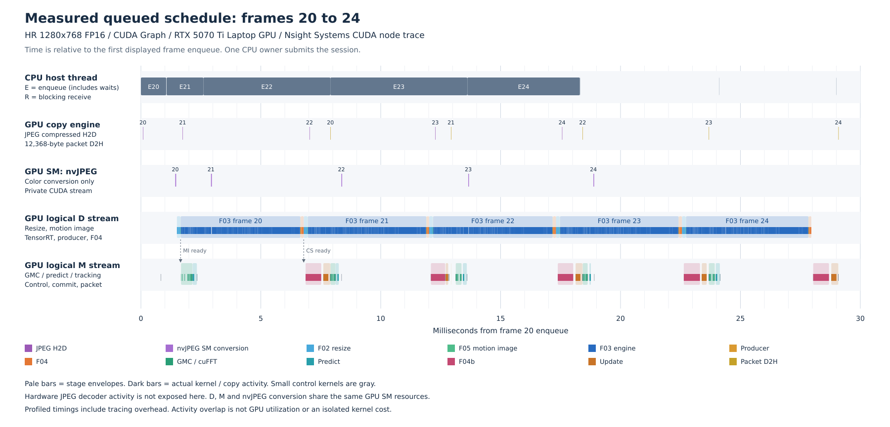

# Saccade 執行排程表

本表依現行 TrackingSession 的事件依賴排程。**表中的等待條件全部保留，才有共享資源的讀寫順序保證；不能以固定毫秒、sleep 或平均延遲代替事件。** 本次條件與驗證結果見 [安全審查](safety-review.md)，硬體和量測界線見 [資源報告](REPORT.md)。

設定：HR 1280×768 FP16、原圖1920×1080、D/M各一條nonblocking stream、單一host owner、MI/CS各2slots、預設HP4slots、D/M各slot一張graph。Nsight的graph虛擬stream ID不代表多加了可共用context的D或M streams。

frame 0 前 constructor 已完成預配置、library warmup 及 device initialization drain。D graph 在首幀取得固定 input 地址後 lazy capture；這個一次性 setup 包含在首幀延遲，已從暖機後樣本分離。

## 事件排程

| 步驟 | 執行硬體 | 工作 | 開始前必須滿足 | 交付或回收 |
| --- | --- | --- | --- | --- |
| H0 | CPU host | ring背壓與RGB回收 | pending < result_slots；如有前幀，host等rgb_read_done(k-1) | 覆寫staging/RGB前完成F05最後讀取 |
| D1 | JPEG hardware + copy + private SM stream | F01 decode(k) | H0；staging/state單份、header/support檢查成功 | nvJPEG交付RGB給D |
| D2 | GPU SM / D | F02 resize(k) | 本幀RGB ready；同D前幀F03完成讀images | 寫固定HR FP32 input |
| D3 | GPU SM / D | F05 motion image(k) | D2；D wait mi_consumed[m]上代（已使用才等） | record mi_ready[m]及rgb_read_done(k) |
| D4 | Tensor Cores + GPU SM / D | D graph F03→producer→F04(k) | D3；更新F04 initialize/finalize metadata；wait cs_consumed[c]上代 | record `cs_ready[c](k)` |
| M1 | GPU SM + cuFFT / M | begin→GMC(k) | M前幀tail+D2H有序；wait `mi_ready[m](k)` | forward FFT與最後MI/header讀完record mi_consumed[m] |
| M2 | GPU SM / M | F08a predict(k) | GMC(k)完成；讀上次committed TS；SPEC由F06讀取 | 本幀PredictedPrior(k) |
| M3 | GPU SM / M | wait CS→candidate checks→F04b(k) | M2及`cs_ready[c](k)` | 獨立BATCH；最後CS讀取完成 |
| M4 | GPU SM / M | F07/F08b→commit→packet(k) | M3；每stage固定run_stage；計算受guard，control/error aggregation/commit/packet照常執行 | 成功才翻轉committed TS/SPEC；record cs_consumed[c] |
| M5 | copy engine / M | 固定12368B packet D2H | M4 packet完成 | record host done[r] |
| H1 | CPU host | receive(k) | host等done[r]，epoch/frame吻合 | copy成獨立value後遞增received，歸還HP |
| H2 | CPU output owner | F09 ID mapping→sequence tail→MOT write | H1 owned packet按frame順序交付 | 序列完成後finish/interpolation/sort/format/write |
| END | CPU host + D/M | finish/cancel/close | 停止提交；finish/cancel獨立drain D和M並保留pending；close再drain含D-only tail | close才destroy graphs→context/plans/buffers/events |

完整欄位（含允許的重疊、限制及slot公式）可匯入 [schedule.csv](schedule.csv)。資源逐項對照見 [ownership.csv](ownership.csv)。

## 實際重疊

本圖直接取自本次queued Nsight trace的固定第20至24幀，淡色為階段首尾範圍，深色為實際kernel/copy activity。JPEG硬體decoder本體未在CUDA trace顯示；紫色SM lane僅是nvJPEG色彩轉換。D、M與nvJPEG conversion使用同一顆GPU的SM和頻寬，並非三套獨立GPU。

- 同幀：MI ready後，F06/GMC與F08a可以先執行；F04b再同時等待本幀CS和本幀predict。
- 跨幀：D(k+1)可以與M(k)重疊；M(k+1)不能越過M(k)的state commit。
- JPEG壓縮資料H2D和packet D2H可以與計算重疊。本機只回報1個async copy engine，不假設兩個方向同時傳輸。
- CPU reader/writer若另開thread，只能各自擁有JPEG bytes或receive回傳packet copies；現行CLI仍是單thread讀取/提交/接收，沒有將reader/writer擴充當成本次已實作功能。

queued D/M kernel activity交集平均1.046ms/幀，97.14%的M kernel活動區間與D相交；跨幀M(k)∩D(k+1)平均0.895ms（119條相鄰幀邊）。這是時間區間相交比例，不是SM利用率，也不是可直接從單幀延遲扣除的節省量。

## 吞吐與交付延遲

同一session有越多pending results，通常越能保持D忙碌，但receive時間也會受host策略推遲。固定4slots的單次probe中，queued吞吐5.379ms/幀，實際enqueue→receive平均21.217ms、p95為21.768ms。兩者是不同指標；序列末端的MOT插值/定稿另有尾端延遲。

| result_slots／最多pending | 吞吐換算ms/幀 | FPS | enqueue→receive平均ms | p95 ms |
| ---: | ---: | ---: | ---: | ---: |
| 1 | 7.002 | 142.8 | 6.993 | 7.379 |
| 2 | 5.396 | 185.3 | 10.740 | 11.259 |
| 4 | 5.401 | 185.1 | 21.289 | 22.452 |

若要保持跨幀重疊並降低交付等待，可從 **result_slots=2** 開始：本次吞吐與4slots相近，平均交付延遲約減半。這是host收送策略與ring深度的選擇，沒有改tracker數值、事件或內部MI/CS各2slots。1slot在每幀收回後再提交，符合較低單幀延遲的用途。

以上depth比較使用相同140張JPEG（20暖機＋120量測）、完整packet bytes比對；每個depth一個fresh session，屬一次觀測，沒有ABBA，不以微小速度差推論穩定優勢。480samples/mode的Graph/ordinary ABBA結果才是資源報告中的主要單幀延遲數字。

## 保持競態安全的使用規則

1. 整個session只由一個host owner操作，frame從0連續遞增；不要同時從另一thread呼叫receive、close或查詢變動狀態。
2. 保留RGB最後讀者的host wait、MI/CS的ready和consumed、HP的done和receive回收；graph replay沒有取消這些邊。
3. TensorRT context/input/raw/F04 scratch只屬D；cuFFT/tracker scratch/CTL/device packet只屬M。要多stream執行同一類工作，必須先重新分配其全部執行資源與leases，不能只增加stream。
4. 失敗不能停止control/packet/event尾段；只允許成功commit推進TS/SPEC。close先drain兩條stream再銷毀graph及借用資源。
5. 新增重疊、改slot/ring、變動pointer/profile/graph範圍或提早回收，都須重新審核ownership及相關byte-equivalence/擾動檢查。現有有限驗證不等於任意函式庫內部與裝置故障的無條件證明。
